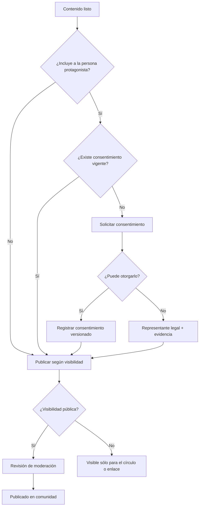
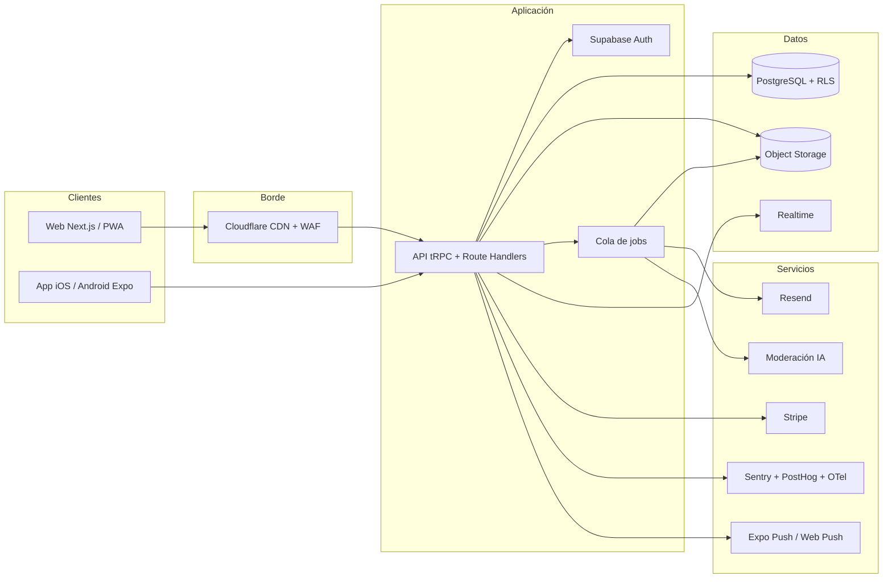

# Especificación técnica y de producto — Mi Experiencia ACV

| Campo | Valor |
|---|---|
| Producto | Mi Experiencia ACV |
| Versión del documento | 1.0 |
| Fecha | Octubre 2026 |
| Estado | Borrador para validación con usuarios, equipo clínico y legal |
| Plataformas | Web responsive (PWA) + iOS + Android |
| Mercado inicial | Chile y Latinoamérica hispanohablante |
| Idioma inicial | Español (es-CL), arquitectura preparada para es-ES, es-MX y en |
| Documento de visión | [`vision-producto.md`](./vision-producto.md) |

---

## Contenido

1. [Resumen ejecutivo](#1-resumen-ejecutivo)
2. [Visión y estrategia](#2-visión-y-estrategia)
3. [Problema y oportunidad](#3-problema-y-oportunidad)
4. [Usuarios y roles](#4-usuarios-y-roles)
5. [Alcance](#5-alcance)
6. [Objetivos y métricas](#6-objetivos-y-métricas)
7. [Requisitos funcionales](#7-requisitos-funcionales)
8. [Historias de usuario y criterios de aceptación](#8-historias-de-usuario-y-criterios-de-aceptación)
9. [Flujos principales](#9-flujos-principales)
10. [Arquitectura técnica](#10-arquitectura-técnica)
11. [Modelo de datos](#11-modelo-de-datos)
12. [API](#12-api)
13. [Seguridad y privacidad](#13-seguridad-y-privacidad)
14. [Requisitos no funcionales](#14-requisitos-no-funcionales)
15. [Accesibilidad, contenido y tono](#15-accesibilidad-contenido-y-tono)
16. [Legal y ética](#16-legal-y-ética)
17. [Analítica, observabilidad y soporte](#17-analítica-observabilidad-y-soporte)
18. [Testing y QA](#18-testing-y-qa)
19. [DevOps y despliegue](#19-devops-y-despliegue)
20. [Roadmap y estimación](#20-roadmap-y-estimación)
21. [Equipo y costos](#21-equipo-y-costos)
22. [Riesgos](#22-riesgos)
23. [Decisiones abiertas](#23-decisiones-abiertas)
24. [Anexos](#24-anexos)

---

## 1. Resumen ejecutivo

Mi Experiencia ACV es un producto web y mobile para familias que atraviesan un accidente cerebrovascular (ACV). Su núcleo es un **espacio privado por familia** donde se documenta la historia de la recuperación —capítulos, momentos, hitos, fotos, audios— y se comparte con un círculo elegido. Alrededor de ese núcleo se articulan una **biblioteca de recursos revisados por especialistas**, una **comunidad moderada de experiencias** y herramientas de **exportación** para convertir el recorrido en memoria (PDF tipo libro, archivo de datos).

La hipótesis central es que **narrar y compartir la experiencia reduce la sensación de aislamiento, ordena la información y mejora la capacidad de la familia para sostener el cuidado**. El producto no diagnostica, no prescribe ni reemplaza la atención clínica: acompaña el proceso humano alrededor del ACV.

La estrategia técnica prioriza tres cosas: **privacidad por diseño** (multi-tenancy con Row Level Security, consentimiento versionado, enlaces revocables), **accesibilidad real** (WCAG 2.2 AA, audio, texto escalable, bajo consumo de datos) y **velocidad de aprendizaje** (monolito modular, PWA primero, apps nativas después de validar retención).

---

## 2. Visión y estrategia

### 2.1 Visión

**Mi Experiencia ACV es el espacio digital donde las familias que atraviesan un accidente cerebrovascular transforman lo vivido en memoria compartida, apoyo mutuo y aprendizaje.** Reunimos en un solo lugar privado la historia de la recuperación, los avances cotidianos y recursos confiables, para que quienes cuidan y quienes se recuperan sostengan el proceso sin sentir que están solos. Aspiramos a que ninguna familia enfrente un ACV sin información, sin apoyo y sin un lugar donde guardar su historia.

### 2.2 Propuesta de valor

| Para | Que | Valor diferencial |
|---|---|---|
| Cuidador/a principal | Ordenar y contar lo que vive sin repetirlo mil veces | Un solo lugar privado, con roles y actualizaciones compartidas |
| Persona que vivió el ACV | Decidir qué se cuenta y cómo | Consentimiento explícito, alias, control por entrada |
| Familia extendida | Saber cómo está y cómo ayudar | Acceso al círculo, reacciones y comentarios cuidados |
| Lector de la comunidad | Encontrar experiencias parecidas | Historias públicas moderadas, filtrables por etapa y rol |
| Profesional aliado | Recomendar recursos sin exponer datos | Biblioteca curada y enlaces de derivación |

### 2.3 Estrategia de producto

1. **Empezar por el espacio privado**, que es donde está la confianza y el valor recurrente.
2. **Abrir la comunidad después**, cuando exista contenido y moderación suficientes; nunca como requisito para usar el producto.
3. **Monetizar sin monetizar datos**: plan gratuito generoso, premium por exportación/libro impreso y planes para instituciones (hospitales, centros de rehabilitación, fundaciones).
4. **Crecer por referidos naturales**: cada espacio invita a su propio círculo; cada historia pública puede convertirse en puerta de entrada.

### 2.4 Modelo de negocio (hipótesis)

| Plan | Precio de referencia | Incluye |
|---|---|---|
| **Gratis** | $0 | 1 espacio, 2 miembros, 500 MB, línea de tiempo, capítulos y exportación JSON |
| **Familia Plus** | ~US$5/mes o ~US$40/año | Miembros ilimitados, 20 GB, PDF tipo libro, enlaces con contraseña, auditoría |
| **Libro impreso** | Pago único | Impresión bajo demanda y envío |
| **Institucional** | Convenio | Panel para hospitales, centros y fundaciones; recursos co-marcados; formación; métricas agregadas |

Principios de monetización:

- El espacio privado esencial nunca se bloquea por completo; el plan gratuito debe ser útil por sí solo.
- No se vende ni se comparte datos de salud; no hay publicidad en el espacio privado.
- El libro impreso es un recuerdo, no una funcionalidad de retención forzada.
- Los convenios institucionales no condicionan la atención ni el acceso de las familias.

---

## 3. Problema y oportunidad

### 3.1 Contexto

Según cifras de referencia de la Organización Mundial de la Salud, cada año alrededor de 15 millones de personas sufren un ACV; cerca de 5 millones fallecen y otros 5 millones quedan con discapacidad permanente. En Chile, el ACV se encuentra entre las principales causas de muerte y de discapacidad adquirida en adultos, y una parte importante del cuidado posterior recae en la familia, sin preparación ni red de apoyo formal.

> **Nota:** estas cifras deben validarse con fuentes locales (MINSAL, DEIS, ENS) antes de usarse en materiales públicos. El documento las incluye solo como marco de contexto.

### 3.2 Dolores de las familias

| Dolor | Consecuencia | Oportunidad de producto |
|---|---|---|
| Información dispersa, contradictoria o demasiado técnica | Ansiedad, decisiones tardías, sensación de descontrol | Biblioteca curada, explicada en lenguaje claro y fechada |
| La historia se pierde entre mensajes, fotos y notas | Duelo sin memoria; la familia no puede reconstruir el proceso | Capítulos, línea de tiempo y exportación a libro |
| WhatsApp fragmenta las novedades | Repetir lo mismo a cada persona; excluir sin querer | Espacio único con roles y resumen semanal |
| El cuidador principal se agota y se aísla | Burnout, deterioro de la salud del cuidador | Círculo de apoyo, comunidad y recursos para cuidadores |
| Miedo a exponer a la persona o a la familia | No se comparte nada; se pierde el apoyo | Privacidad granular, alias, enlaces revocables |
| Trámites, rehabilitación y cambios de etapa | Confusión sobre qué hacer y a quién acudir | Guías por etapa y directorio de recursos |

### 3.3 Alternativas actuales y por qué no bastan

| Alternativa | Fortaleza | Limitación para este caso |
|---|---|---|
| WhatsApp / Telegram | Ubicuidad, bajo esfuerzo | Sin estructura, sin roles, sin memoria, notificaciones invasivas |
| CaringBridge y similares | Cercanía al concepto | Poco adaptado al español/LATAM, recursos locales escasos, poca granularidad de consentimiento |
| Notion / Google Docs | Flexibilidad | Curva de aprendizaje, sin privacidad pensada para salud, sin comunidad |
| Blogs / Instagram | Narrativa y alcance | Exposición pública por defecto, sin protección de identidad, sin moderación clínica |
| Grupos de Facebook | Apoyo entre pares | Desinformación, falta de privacidad, difícil de buscar y archivar |

### 3.4 Oportunidad

Un producto que combine **memoria privada + apoyo del círculo + recursos confiables + comunidad moderada** no existe con foco hispanohablante y sensibilidad local. La ventana es especialmente relevante por la entrada en vigencia de la nueva ley chilena de protección de datos (Ley 21.719, diciembre de 2026), que eleva el estándar de consentimiento y tratamiento de datos sensibles: quien llegue con privacidad por diseño tendrá ventaja regulatoria y de confianza.

---

## 4. Usuarios y roles

### 4.1 Proto-personas

| Persona | Perfil | Necesidad principal | Miedo / fricción |
|---|---|---|---|
| **Carolina, 42** | Hija cuidadora, Santiago, trabaja y cuida a su madre | Ordenar la información y actualizar a la familia sin repetir | Quedar mal, olvidar algo importante, exponer a su madre |
| **Jorge, 68** | Esposo, poca familiaridad digital | Ver cómo está su esposa y sentirse útil | Interfaces complejas, letra pequeña, sentirse excluido |
| **Valentina, 19** | Nieta, nativa digital | Aportar fotos y acompañar desde lejos | Que su abuela aparezca sin consentimiento |
| **Marta, 71** | Protagonista, afasia leve | Que su historia se cuente bien y decidir qué se comparte | Que hablen por ella, que la muestren vulnerable |
| **Dra. Rojas, 38** | Fonoaudióloga | Recomendar recursos y hacer seguimiento sin invadir | Que se mezcle su rol clínico con la familia |
| **Andrés, 50** | Lector de la comunidad | Encontrar a alguien que haya vivido algo parecido | Leer consejos peligrosos o relatos que lo angustien |

### 4.2 Roles y permisos

| Rol | Descripción | Puede |
|---|---|---|
| `owner` | Creador/a del espacio; responsabilidad legal y de gobernanza | Todo, incluida transferencia, eliminación y consentimientos |
| `admin` | Coordina el espacio | Invitar, moderar miembros, editar cualquier contenido, configurar privacidad |
| `editor` | Edita la historia y la línea de tiempo | Crear/editar/publicar contenido, subir media, invitar con aprobación |
| `contributor` | Aporta momentos y comentarios | Crear y editar su propio contenido, comentar, reaccionar |
| `reader` | Sólo lectura | Ver contenido del círculo, comentar si se habilita, reaccionar |
| `professional` | Aliado clínico invitado | Ver lo que se le comparte, dejar recomendaciones marcadas como profesionales; no edita la historia |
| `public` | Visitante sin cuenta | Ver sólo contenido público o enlaces compartidos vigentes |

Reglas clave:

- El `owner` es único por espacio y debe transferirse explícitamente antes de eliminar su cuenta.
- Un usuario puede pertenecer a varios espacios con roles distintos.
- Los permisos se verifican **siempre en el servidor**; la UI sólo los refleja.
- El rol `professional` nunca accede a contenido marcado como `private` ni a datos de contacto sin consentimiento.

---

## 5. Alcance

### 5.1 MVP (lanzamiento privado, 10–12 semanas)

| Incluido | Detalle |
|---|---|
| Cuentas | Magic link, Google/Apple, perfil, sesiones, eliminación con gracia |
| Espacio familiar | Crear, invitar, roles, varios espacios, portada |
| Historia | Capítulos con editor enriquecido, borrador/publicado, visibilidad |
| Momentos | Entradas con fecha, categoría, texto, mood, multimedia |
| Línea de tiempo | Vista cronológica, hitos destacados, filtros básicos |
| Privacidad | 4 niveles de visibilidad, enlaces revocables, consentimiento versionado |
| Multimedia | Imágenes, audio, video corto, PDF; alt text; optimización |
| Círculo | Comentarios, reacciones, resumen semanal por email |
| Recursos | 25–30 fichas revisadas, emergencias por país, glosario |
| Exportación | PDF tipo libro y archivo JSON/ZIP |
| Administración | Reportes, moderación manual, auditoría |
| Accesibilidad | WCAG 2.2 AA, texto escalable, navegación por teclado |
| Plataforma | Web responsive instalable (PWA) |

### 5.2 V1 (pública, ~8 semanas después del MVP)

- Apps nativas iOS/Android (Expo).
- Comunidad pública de historias con moderación previa.
- Transcripción automática de audio (opt-in).
- Exportación a libro impreso bajo demanda.
- Acceso de profesionales y enlaces de derivación.
- Planes premium y panel para instituciones.
- Notificaciones push y centro de notificaciones.

### 5.3 Futuro

- Modo memorial y gobernanza post-fallecimiento.
- Directorio verificado de centros y profesionales.
- Integraciones con hospitales (FHIR de sólo lectura, nunca como requisito).
- Traducción y localización a portugués e inglés.
- Grupos de apoyo facilitados por profesionales.
- Biblioteca de ejercicios de rehabilitación **prescritos** (sólo con alianza clínica).

### 5.4 Fuera de alcance (explícito)

- Historia clínica electrónica, diagnóstico, prescripción o telemedicina.
- Gestión de medicamentos, dosis o alertas de adherencia.
- Tramitación de seguros, licencias o beneficios.
- Monitoreo en tiempo real o dispositivos médicos.
- Consejo médico automatizado o triaje de emergencias.
- Publicidad basada en datos de salud.

---

## 6. Objetivos y métricas

### 6.1 Objetivos de producto (12 meses)

1. Validar que el espacio privado genera hábito y valor percibido en al menos 300 familias.
2. Lograr que el 40% de los espacios active a su círculo (≥2 miembros) en la primera semana.
3. Construir una biblioteca de recursos con revisión clínica y fecha de vigencia.
4. Operar la comunidad pública con un SLA de moderación menor a 24 horas.
5. Alcanzar accesibilidad AA verificada y cero incidentes graves de privacidad.

### 6.2 North Star y KPIs

| Métrica | Definición | Meta 6 meses | Meta 12 meses |
|---|---|---|---|
| **North Star** | Espacios con ≥3 momentos y ≥2 miembros activos en 30 días | 150 | 400 |
| Activación | Crear espacio + invitar + primera entrada en 7 días | 45% | 55% |
| Retención W4 | Usuarios que vuelven en la semana 4 | 30% | 40% |
| Retención W12 | Usuarios que vuelven en la semana 12 | 15% | 25% |
| Miembros por espacio | Promedio de miembros activos | 2,5 | 3,5 |
| Exportación | Espacios que exportan PDF o JSON | 10% | 18% |
| NPS | Recomendación de cuidadores | 30 | 45 |
| Moderación | Reportes resueltos en <24 h | 90% | 95% |
| Accesibilidad | Flujos críticos sin blockers AA | 100% | 100% |
| Privacidad | Incidentes graves | 0 | 0 |

### 6.3 Métricas de salud del negocio

- Costo de infraestructura por espacio activo.
- Conversión a premium (libro/impresión/plan familiar).
- Ingresos por instituciones vs. consumidor.
- Costo de moderación por 1.000 historias públicas.
- CAC orgánico vs. pagado (si se activa).

---

## 7. Requisitos funcionales

Prioridad MoSCoW: **M** = must, **S** = should, **C** = could, **W** = won't (esta versión).

### 7.1 Cuenta y acceso

| ID | Requisito | Prioridad |
|---|---|---|
| RF-001 | Registro e inicio de sesión con magic link (email) y OAuth con Apple/Google. | M |
| RF-002 | Perfil con nombre, alias, foto, idioma, zona horaria y pronombres opcionales. | M |
| RF-003 | Verificación de email y recuperación de acceso. | M |
| RF-004 | Gestión de sesiones activas por dispositivo, con cierre remoto. | M |
| RF-005 | Eliminación de cuenta con período de gracia de 30 días y exportación previa. | M |
| RF-006 | 2FA obligatorio para roles administrativos y de moderación. | S |
| RF-007 | Passkeys como método opcional. | C |

### 7.2 Espacio familiar

| ID | Requisito | Prioridad |
|---|---|---|
| RF-010 | Crear espacio con nombre, protagonista, relación, fecha y tipo de ACV (opcional), visibilidad por defecto. | M |
| RF-011 | El creador es `owner`; puede transferir la propiedad y designar un suplente. | M |
| RF-012 | Invitar por email o enlace con rol, mensaje y caducidad. | M |
| RF-013 | Aceptar invitación, unirse, salir; el `owner`/`admin` puede remover miembros. | M |
| RF-014 | Cambiar roles y permisos con registro de auditoría. | M |
| RF-015 | Varios espacios por usuario y cambio rápido entre ellos. | S |
| RF-016 | Portada, color de acento y nombre visible del espacio. | C |
| RF-017 | Archivar espacio y activar modo memorial. | S |
| RF-018 | Vista "Resumen para la familia" con lo último y lo pendiente. | C |

### 7.3 Historia y capítulos

| ID | Requisito | Prioridad |
|---|---|---|
| RF-020 | Editor de texto enriquecido: títulos, listas, citas, enlaces, imágenes, audio embebido. | M |
| RF-021 | Capítulos con título, resumen, portada, estado borrador/publicado y visibilidad. | M |
| RF-022 | Autoguardado cada 10 s y historial de versiones con restauración. | S |
| RF-023 | Ordenar capítulos y generar tabla de contenidos. | M |
| RF-024 | Tiempo estimado de lectura y navegación anterior/siguiente. | C |
| RF-025 | Plantillas y preguntas guía para escribir ("¿Cómo fue el primer día?", "¿Qué aprendimos?"). | S |
| RF-026 | Coautoría con atribución y menciones. | C |

### 7.4 Línea de tiempo y momentos

| ID | Requisito | Prioridad |
|---|---|---|
| RF-030 | Crear entradas con fecha/hora, título, texto, categoría, mood y multimedia. | M |
| RF-031 | Categorías: diagnóstico, hospitalización, rehabilitación, avance, terapia, vida cotidiana, hito, recaída, pérdida. | M |
| RF-032 | Vista cronológica y vista calendario. | M |
| RF-033 | Marcar hitos destacados y fijarlos en la portada del espacio. | M |
| RF-034 | Filtrar por autor, categoría, fecha y etiqueta. | S |
| RF-035 | Sección "Este día" con recuerdos de fechas anteriores. | C |
| RF-036 | Mood y energía con escala visual opcional (nunca obligatoria). | S |
| RF-037 | Edición y eliminación con papelera de 30 días. | M |

### 7.5 Diario y multimedia

| ID | Requisito | Prioridad |
|---|---|---|
| RF-040 | Subida de imágenes (JPEG, PNG, HEIC, WebP), audio (M4A, MP3), video corto (≤3 min) y PDF. | M |
| RF-041 | Transcripción automática de audio con opt-in explícito. | C |
| RF-042 | Texto alternativo obligatorio para imágenes públicas; sugerido en privadas. | M |
| RF-043 | Galería y visor con descarga y atribución. | M |
| RF-044 | Cuotas de almacenamiento por plan y aviso al 80%. | M |
| RF-045 | Borradores offline en PWA con sincronización al recuperar conexión. | S |
| RF-046 | Etiquetas y búsqueda de contenido. | S |
| RF-047 | Difuminado manual de rostros antes de publicar. | C |

### 7.6 Círculo y colaboración

| ID | Requisito | Prioridad |
|---|---|---|
| RF-050 | Feed del espacio con entradas, capítulos e hitos. | M |
| RF-051 | Comentarios y reacciones con copy cuidado ("Te acompaño", "Gracias", "Fuerza"). | M |
| RF-052 | Menciones y notificaciones asociadas. | S |
| RF-053 | Resumen semanal por email con lo nuevo y lo que viene. | S |
| RF-054 | Muro de necesidades del círculo ("Necesito compañía el jueves", "Puedo llevar comida"). | C |
| RF-055 | Calendario compartido de visitas y terapias (sin datos clínicos detallados). | C |

### 7.7 Privacidad, consentimiento y legado

| ID | Requisito | Prioridad |
|---|---|---|
| RF-060 | Privacidad por defecto: espacio privado, `noindex`, sin descubrimiento. | M |
| RF-061 | Visibilidad por entrada: `private`, `circle`, `link`, `public`. | M |
| RF-062 | Enlaces compartidos con caducidad, contraseña opcional, límite de usos y revocación. | M |
| RF-063 | Consentimiento del protagonista o representante legal, versionado y con evidencia. | M |
| RF-064 | Revocación de consentimiento con despublicación inmediata y notificación. | M |
| RF-065 | Modo alias y ocultamiento de datos identificatorios. | S |
| RF-066 | Exportación completa (JSON + media) y PDF en cualquier momento. | M |
| RF-067 | Modo memorial con reglas de gobernanza acordadas en vida. | C |
| RF-068 | Registro de auditoría visible para el `owner`. | S |
| RF-069 | Bloqueo de descargas y marca de agua opcional en enlaces compartidos. | C |

### 7.8 Comunidad pública

| ID | Requisito | Prioridad |
|---|---|---|
| RF-070 | Publicar una historia en la comunidad con opt-in y revisión previa. | S |
| RF-071 | Explorar por tema, etapa, tipo de ACV y rol de quien escribe. | S |
| RF-072 | Comentarios moderados y reacciones en historias públicas. | S |
| RF-073 | Reportar contenido y bloquear usuarios. | M |
| RF-074 | Guías de comunidad y consentimiento explícito antes de publicar. | M |
| RF-075 | Búsqueda de historias por texto y filtros. | C |
| RF-076 | Seguir autores y temas. | C |
| RF-077 | Aviso de contenido sensible antes de abrir relatos crudos. | S |

### 7.9 Recursos y acompañamiento

| ID | Requisito | Prioridad |
|---|---|---|
| RF-080 | Biblioteca curada: qué es un ACV, señales de alarma, rehabilitación, afasia, cuidado del cuidador, trámites. | M |
| RF-081 | Fichas con fuente, autor clínico, fecha de revisión y disclaimer. | M |
| RF-082 | Guardar recursos y crear colecciones personales. | S |
| RF-083 | Directorio de emergencias por país, siempre visible. | M |
| RF-084 | Directorio de centros y profesionales verificados (sin pago por ranking). | C |
| RF-085 | Glosario y preguntas frecuentes en lenguaje claro. | M |
| RF-086 | Contenido en audio y lectura fácil para personas con afasia o baja visión. | S |

### 7.10 Exportación y memoria

| ID | Requisito | Prioridad |
|---|---|---|
| RF-090 | PDF tipo libro con capítulos, línea de tiempo y fotos. | S |
| RF-091 | Exportación DOCX, JSON y ZIP con todos los medios. | C |
| RF-092 | Impresión bajo demanda con proveedor asociado. | W (V1) |
| RF-093 | Enlace de libro digital con caducidad. | C |
| RF-094 | Vista previa antes de exportar y elección de contenido. | S |

### 7.11 Notificaciones

| ID | Requisito | Prioridad |
|---|---|---|
| RF-100 | Notificaciones por invitación, comentario, mención, hito y resumen semanal. | M |
| RF-101 | Preferencias granulares por canal y horarios de silencio. | M |
| RF-102 | Centro de notificaciones in-app con estado leído. | S |
| RF-103 | Copy no culpabilizante y frecuencia configurable; nada de "te extrañamos". | M |
| RF-104 | Push web y mobile; email como respaldo. | S |

### 7.12 Moderación y administración

| ID | Requisito | Prioridad |
|---|---|---|
| RF-110 | Panel de reportes con prioridad, SLA y asignación. | M |
| RF-111 | Moderación automática de texto e imagen en contenido público. | S |
| RF-112 | Acciones: ocultar, advertir, suspender, restaurar y apelar. | M |
| RF-113 | Auditoría inmutable de acciones de moderación. | M |
| RF-114 | Panel de métricas de uso, retención y salud del servicio. | S |
| RF-115 | Gestión de recursos con flujo de revisión clínica y caducidad. | S |
| RF-116 | Exportación de reportes para transparencia anual. | C |

### 7.13 Accesibilidad e internacionalización

| ID | Requisito | Prioridad |
|---|---|---|
| RF-120 | Cumplimiento WCAG 2.2 nivel AA en flujos críticos. | M |
| RF-121 | Navegación completa por teclado y lectores de pantalla. | M |
| RF-122 | Texto escalable al 200% sin pérdida de contenido; modo alto contraste. | M |
| RF-123 | Subtítulos y transcripción para audio/video. | S |
| RF-124 | Arquitectura i18n con es-CL inicial y formato de fechas local. | M |
| RF-125 | Lenguaje claro y lectura fácil en contenido esencial. | M |
| RF-126 | Modo de bajo consumo de datos y carga progresiva de imágenes. | C |

---

## 8. Historias de usuario y criterios de aceptación

### HU-01 · Crear un espacio y invitar a la familia

**Como** hija cuidadora **quiero** crear un espacio para mi madre y invitar a mi familia **para** dejar de repetir novedades por WhatsApp.

**Criterios de aceptación**

- **Dado** que inicié sesión, **cuando** completo nombre del espacio, nombre o alias de mi madre y visibilidad, **entonces** se crea el espacio conmigo como `owner` y veo la portada vacía con una acción clara para contar el primer momento.
- **Dado** que estoy en el espacio, **cuando** invito a un familiar por email con rol `reader`, **entonces** se envía una invitación con caducidad de 14 días y veo su estado (pendiente/aceptada).
- **Dado** un enlace de invitación vencido, **cuando** alguien lo abre, **entonces** ve un mensaje claro y puede pedir uno nuevo al `owner`.
- **Dado** que el familiar acepta, **entonces** sólo ve el contenido permitido por su rol y no puede editar la historia.

### HU-02 · Publicar un momento con privacidad granular

**Como** cuidadora **quiero** registrar un momento y decidir quién lo ve **para** compartir sin exponer a mi madre.

**Criterios de aceptación**

- **Dado** el formulario de nuevo momento, **cuando** guardo sin elegir visibilidad, **entonces** queda en `circle` (valor por defecto del espacio).
- **Dado** que elijo `private`, **entonces** sólo yo lo veo, incluso si soy `editor`.
- **Dado** que elijo `link`, **entonces** puedo generar un enlace con caducidad y revocarlo; el contenido no aparece en búsquedas ni en la comunidad.
- **Dado** que adjunto una foto, **entonces** se eliminan los metadatos EXIF y se generan miniaturas antes de publicar.
- **Dado** que publico, **entonces** los miembros con permiso reciben una notificación según sus preferencias y el `owner` ve el registro en auditoría.

### HU-03 · Revocar el consentimiento de la persona protagonista

**Como** persona que vivió el ACV **quiero** retirar mi consentimiento **para** que mi historia deje de estar visible.

**Criterios de aceptación**

- **Dado** que soy el sujeto del consentimiento o su representante legal, **cuando** revoco, **entonces** todo el contenido marcado como dependiente de ese consentimiento se despublica en menos de 5 minutos.
- **Dado** que había enlaces activos, **entonces** se invalidan de inmediato.
- **Dado** que el contenido estaba en la comunidad, **entonces** se retira y se notifica al equipo de moderación.
- **Dado** que la revocación ocurre, **entonces** queda registro con fecha, hora, versión del texto y actor, sin posibilidad de edición.

### HU-04 · Exportar la historia como libro

**Como** familia **quiero** descargar un PDF con los capítulos, la línea de tiempo y las fotos **para** conservarlo y compartirlo.

**Criterios de aceptación**

- **Dado** que soy `owner` o `admin`, **cuando** solicito la exportación, **entonces** puedo elegir capítulos, rango de fechas e incluir o no fotos.
- **Dado** que la exportación tarda, **entonces** veo el estado y recibo una notificación al estar lista.
- **Dado** que el PDF está listo, **entonces** el enlace de descarga caduca en 24 horas y el archivo se elimina a los 7 días.
- **Dado** que el contenido incluye material de terceros, **entonces** se respetan atribuciones y licencias.

### HU-05 · Reportar una historia pública

**Como** lector **quiero** reportar contenido que expone a alguien o da consejos médicos peligrosos **para** proteger a la comunidad.

**Criterios de aceptación**

- **Dado** que estoy en una historia pública, **cuando** reporto con un motivo, **entonces** recibo confirmación y el reporte entra a la cola con prioridad según categoría.
- **Dado** un reporte de riesgo alto (exposición de menores, datos identificatorios, consejo médico peligroso), **entonces** el contenido se oculta preventivamente y se alerta al equipo.
- **Dado** que el equipo resuelve, **entonces** se notifica al autor con la decisión y el derecho a apelar.

---

## 9. Flujos principales

### 9.1 Onboarding y creación del espacio

```mermaid
flowchart TD
    A[Landing: "Tu historia importa"] --> B{¿Tiene cuenta?}
    B -- No --> C[Magic link o Apple/Google]
    B -- Sí --> D[Iniciar sesión]
    C --> E[Crear perfil mínimo]
    D --> E
    E --> F[Crear espacio: nombre y protagonista]
    F --> G[Elegir privacidad por defecto]
    G --> H[Invitar al círculo]
    H --> I[Primer momento guiado]
    I --> J[Portada del espacio]
    J --> K[Recursos recomendados según etapa]
```

Principios del onboarding:

- Máximo 4 pasos antes de ver valor.
- Todo campo es opcional salvo nombre del espacio y aceptación de términos.
- Se puede omitir la invitación y hacerla después.
- Nunca se pide el diagnóstico como requisito para usar el producto.

### 9.2 Consentimiento y publicación



### 9.3 Invitación y incorporación al círculo

1. `owner`/`admin` invita por email o genera enlace.
2. El sistema crea un token de un solo uso, con hash en base de datos y caducidad.
3. La persona invitada abre el enlace, ve una vista previa limitada y acepta.
4. Se crea la membresía con el rol asignado y se registra en auditoría.
5. Si el rol es `professional`, se solicita número de registro y se marca la cuenta como verificada.

### 9.4 Exportación

1. El usuario elige formato, contenido y rango.
2. Se encola un job; la UI muestra progreso.
3. El worker genera el PDF/ZIP y lo sube a almacenamiento privado.
4. Se emite un enlace firmado de 24 h y se notifica.
5. Un job de limpieza elimina el archivo a los 7 días.

### 9.5 Eliminación de cuenta o espacio

1. Se solicita con confirmación escrita y, si hay más miembros, se exige transferencia de propiedad.
2. Se inicia período de gracia de 30 días con opción de cancelar.
3. Al vencer, se elimina lógicamente y se purga en 30 días; los respaldos expiran en 35 días.
4. Se conserva sólo lo estrictamente legal (registros de consentimiento y auditoría) de forma disociada.

---

## 10. Arquitectura técnica

### 10.1 Vista general



**Decisión:** monolito modular, no microservicios. El dominio se separa por módulos (`identity`, `spaces`, `entries`, `chapters`, `media`, `consent`, `community`, `resources`, `exports`, `notifications`, `moderation`) con límites claros y comunicación por casos de uso. Los jobs pesados (PDF, transcodificación, transcripción, moderación) van a una cola.

**Justificación:** equipo pequeño, dominio aún en validación, necesidad de velocidad. La separación lógica permite extraer servicios si el volumen lo exige.

### 10.2 Stack recomendado

| Capa | Tecnología | Motivo |
|---|---|---|
| Web | Next.js 15+ (App Router), React 19+, TypeScript | SSR/RSC, SEO para contenido público, ecosistema |
| Estilos | Tailwind CSS 4 + shadcn/ui (Radix) | Velocidad, accesibilidad de base, consistencia |
| Mobile | Expo SDK 54+ (React Native), expo-router | Código compartido, OTA, acceso nativo a cámara/audio |
| API | tRPC v11 + Zod; REST/OpenAPI para socios | Tipado extremo a extremo y contrato público |
| Base de datos | PostgreSQL 16 (Supabase) | RLS, JSONB, búsqueda full-text, madurez |
| ORM/migraciones | Drizzle ORM + drizzle-kit | SQL explícito, migraciones versionadas |
| Auth | Supabase Auth (magic link, OAuth, passkeys) | Menos superficie propia, sesiones seguras |
| Storage | Supabase Storage / S3 compatible | URLs firmadas, políticas por bucket |
| Realtime | Supabase Realtime | Comentarios y presencia en el espacio |
| Email | Resend + React Email | Plantillas versionadas, buena entregabilidad |
| Push | Expo Notifications + Web Push (VAPID) | Cobertura web y mobile |
| Jobs | pg-boss o BullMQ + Redis | Simplicidad; reintentos y DLQ |
| PDF | React-PDF o Playwright + plantilla HTML | Control de diseño y accesibilidad |
| Media | sharp, ffmpeg, ClamAV | Optimización, transcodificación, antivirus |
| Búsqueda | PostgreSQL FTS + pg_trgm | Suficiente para MVP; Meilisearch si escala |
| Analítica | PostHog (EU/self-host) | Eventos, embudos y flags con control de datos |
| Errores | Sentry con scrubbing de PII | Diagnóstico sin filtrar datos sensibles |
| Pagos | Stripe | Suscripciones, impresión, facturación |
| Infra | Vercel (web) + Supabase (datos) + Cloudflare | Baja operación, escala elástica |
| CI/CD | GitHub Actions + EAS | Pruebas, migraciones, builds móviles |
| Tests | Vitest, Playwright, Maestro, k6, pgTAP | Cobertura de unidad a carga y RLS |

> Las versiones son orientativas y deben fijarse en el `package.json` y en la documentación de despliegue. Se recomienda actualizar de forma programada y no automática en producción.

### 10.3 Estructura del monorepo

```text
mi-experiencia-acv/
├─ apps/
│  ├─ web/                 # Next.js (PWA)
│  ├─ mobile/              # Expo (iOS/Android)
│  └─ admin/               # Panel de moderación (puede ser ruta de web)
├─ packages/
│  ├─ api/                 # Routers tRPC, casos de uso, validaciones
│  ├─ db/                  # Esquema Drizzle, migraciones, seeds
│  ├─ ui/                  # Componentes compartidos (web/native)
│  ├─ domain/              # Entidades, reglas, permisos
│  ├─ emails/              # Plantillas React Email
│  ├─ config/              # ESLint, TS, Tailwind, env
│  └─ testing/             # Fixtures y utilidades
├─ infra/
│  ├─ supabase/            # Políticas RLS, funciones, migraciones SQL
│  └─ scripts/             # Backups, restore, limpieza
├─ docs/
│  ├─ vision-producto.md
│  ├─ especificacion-tecnica.md
│  ├─ api.md
│  └─ runbooks/
├─ turbo.json
├─ pnpm-workspace.yaml
└─ package.json
```

### 10.4 Decisiones de arquitectura (ADR resumidos)

| ADR | Decisión | Alternativas consideradas | Consecuencia |
|---|---|---|---|
| ADR-001 | Monolito modular | Microservicios | Menor complejidad operativa; extraer si hace falta |
| ADR-002 | Multi-tenancy con schema compartido + RLS | Schema por familia, DB por familia | Costo bajo y aislamiento fuerte si las políticas se prueban |
| ADR-003 | PWA primero, nativo después | Nativo primero | Validación más rápida; push iOS limitado en PWA |
| ADR-004 | tRPC interno + REST público | GraphQL | Menos sobrecarga; REST es más fácil para socios |
| ADR-005 | Supabase como plataforma | NestJS + Prisma autogestionado | Menos tiempo en infraestructura; dependencia del proveedor |
| ADR-006 | Postgres FTS antes que buscador externo | Meilisearch/Elastic | Menos costo; migrar si la relevancia no alcanza |
| ADR-007 | Exportación asíncrona | Síncrona | Evita timeouts y permite libros grandes |

### 10.5 SEO y contenido público

- Renderizado SSR/ISR para historias públicas y recursos; el espacio privado nunca se indexa.
- `noindex, nofollow` en espacios privados, enlaces compartidos, borradores y vistas previas.
- Sitemap segmentado, `canonical` y `hreflang` cuando existan varios idiomas.
- Open Graph y Twitter Cards sin datos sensibles ni nombres reales.
- Datos estructurados (`Article`, `FAQPage`) sólo en contenido público revisado.
- Slugs legibles sin nombres reales; edición con redirección 301.
- Core Web Vitals monitoreados por ruta pública.

### 10.6 IA y automatización

| Caso | Fase | Guardrails |
|---|---|---|
| Transcripción de audio | V1, opt-in | Consentimiento explícito, proveedor con retención cero, opción de borrar el audio original |
| Preguntas guía para escribir | V1 | Prompts genéricos; no redacta por el usuario |
| Resumen semanal | V1 | Sólo hechos del espacio; revisión humana antes de enviar |
| Moderación de texto e imagen | MVP/V1 | Clasificador + revisión humana; falsos positivos apelables |
| Traducción | Futuro | Opt-in y revisión humana en contenido clínico |

Reglas transversales:

- No se entrena ningún modelo con datos de usuarios.
- La IA no entrega diagnóstico, dosis ni consejo médico personalizado.
- Se registra la versión del modelo y se puede desactivar por espacio.
- Se evalúan sesgos y calidad por idioma antes de habilitar.
- Todo proveedor debe tener DPA, retención cero y región compatible.
- Ningún dato P3 se envía sin redacción o consentimiento específico.

---

## 11. Modelo de datos

### 11.1 Entidades principales

| Entidad | Propósito | Campos clave |
|---|---|---|
| `users` | Cuenta de persona | `id`, `email`, `name`, `alias`, `locale`, `timezone`, `status`, `created_at` |
| `care_spaces` | Espacio de una familia | `id`, `slug`, `name`, `protagonist_name`, `relationship`, `stroke_date`, `stroke_type`, `status`, `default_visibility` |
| `care_space_members` | Membresía y rol | `care_space_id`, `user_id`, `role`, `status`, `joined_at` |
| `invitations` | Invitaciones pendientes | `id`, `care_space_id`, `email`, `role`, `token_hash`, `expires_at`, `accepted_at` |
| `chapters` | Relato largo | `id`, `care_space_id`, `title`, `summary`, `body`, `status`, `visibility`, `position` |
| `entries` | Momentos y hitos | `id`, `care_space_id`, `author_id`, `kind`, `title`, `body`, `occurred_at`, `category`, `mood`, `visibility` |
| `media_assets` | Archivos | `id`, `owner_id`, `care_space_id`, `type`, `storage_path`, `mime`, `bytes`, `alt_text`, `status` |
| `comments` | Comentarios | `id`, `thread_type`, `thread_id`, `author_id`, `body`, `status` |
| `reactions` | Reacciones | `id`, `target_type`, `target_id`, `user_id`, `type` |
| `share_links` | Enlaces externos | `id`, `care_space_id`, `scope`, `token_hash`, `expires_at`, `max_uses`, `revoked_at` |
| `consents` | Consentimientos | `id`, `care_space_id`, `subject_user_id`, `type`, `version`, `granted_at`, `revoked_at`, `evidence` |
| `resources` | Biblioteca | `id`, `slug`, `title`, `category`, `body`, `source_url`, `reviewed_by`, `reviewed_at` |
| `notifications` | Avisos | `id`, `user_id`, `type`, `payload`, `read_at`, `channel` |
| `reports` | Reportes de moderación | `id`, `target_type`, `target_id`, `reason`, `status`, `priority`, `resolved_by` |
| `audit_logs` | Trazabilidad | `id`, `actor_id`, `action`, `entity_type`, `entity_id`, `care_space_id`, `metadata`, `created_at` |
| `exports` | Trabajos de exportación | `id`, `care_space_id`, `format`, `status`, `file_path`, `expires_at` |
| `subscriptions` | Planes | `id`, `user_id`, `plan`, `status`, `stripe_customer_id` |

### 11.2 Relaciones

```text
users 1—N care_space_members N—1 care_spaces
care_spaces 1—N chapters
care_spaces 1—N entries
entries 1—N media_assets (vía entry_media)
care_spaces 1—N consents
care_spaces 1—N share_links
entries/chapters 1—N comments
entries/chapters 1—N reactions
care_spaces 1—N exports
users 1—N notifications
```

### 11.3 Reglas de integridad

- Toda tabla con contenido de una familia lleva `care_space_id` y política RLS.
- `care_space_members` tiene unicidad `(care_space_id, user_id)`.
- Sólo un `owner` activo por espacio; se garantiza con índice parcial.
- `entries.occurred_at` no puede ser futura salvo que el espacio lo permita (recordatorios).
- `media_assets` se marca `quarantined` hasta pasar antivirus y procesamiento.
- Los borrados son lógicos (`deleted_at`) y la purga es un job separado.
- Las versiones de consentimiento son inmutables; se crea una nueva fila por cambio.

### 11.4 Estrategia de multi-tenancy y RLS

Se usa **una base de datos compartida con aislamiento por fila**. Cada tabla de contenido tiene `care_space_id`; las políticas verifican membresía activa y rol mínimo.

```sql
create type member_role as enum ('owner','admin','editor','contributor','reader','professional');
create type visibility as enum ('private','circle','link','public');

create or replace function app.role_rank(r member_role)
returns int language sql immutable as $$
  select case r
    when 'reader' then 1
    when 'professional' then 2
    when 'contributor' then 3
    when 'editor' then 4
    when 'admin' then 5
    when 'owner' then 6
  end;
$$;

create or replace function app.is_member(space uuid, min_role member_role default 'reader')
returns boolean
language sql stable security definer set search_path = public as $$
  select exists (
    select 1
    from care_space_members m
    where m.care_space_id = space
      and m.user_id = auth.uid()
      and m.status = 'active'
      and app.role_rank(m.role) >= app.role_rank(min_role)
  );
$$;

alter table entries enable row level security;

create policy entries_select on entries
for select using (
  app.is_member(care_space_id)
  and (visibility <> 'private' or author_id = auth.uid())
);

create policy entries_insert on entries
for insert with check (
  app.is_member(care_space_id, 'contributor')
  and author_id = auth.uid()
);

create policy entries_update on entries
for update using (
  app.is_member(care_space_id, 'editor')
  or (author_id = auth.uid() and app.is_member(care_space_id, 'contributor'))
)
with check (
  app.is_member(care_space_id, 'editor')
  or (author_id = auth.uid() and app.is_member(care_space_id, 'contributor'))
);
```

Reglas adicionales:

- Un trigger `prevent_tenant_reassignment` bloquea cambios de `care_space_id` y `author_id`; la visibilidad sólo cambia mediante el caso de uso correspondiente.
- `professional` no accede a `private` ni a datos de contacto; se lee mediante vistas restringidas.
- El acceso a `link` se resuelve en el servidor con el token; nunca con RLS de `anon` directo.
- Las políticas se prueban con **pgTAP** en CI: matriz de rol × visibilidad × acción.
- Ninguna consulta de la aplicación usa `service_role` salvo jobs internos y administración auditada.

### 11.5 Clasificación de datos

| Nivel | Ejemplos | Controles |
|---|---|---|
| P0 · Público | Historias publicadas, recursos | Moderación, sin datos identificatorios por defecto |
| P1 · Interno | Métricas agregadas, configuración | Acceso por rol, sin PII |
| P2 · Personal | Email, nombre, foto de perfil | Cifrado en tránsito/reposo, acceso mínimo |
| P3 · Sensible | Diagnóstico, evolución, fotos, audios, consentimientos | Cifrado, RLS estricta, auditoría, retención definida, sin analítica |

**Regla:** ningún evento analítico, log o mensaje de error puede contener datos P3. Se redacta en origen, no en el destino.

### 11.6 Retención

| Dato | Retención | Excepción |
|---|---|---|
| Contenido activo | Hasta eliminación por el usuario | — |
| Cuenta eliminada | 30 días de gracia + 30 de purga | Obligaciones legales |
| Respaldos | 35 días | Restauración ante incidente |
| Enlaces de exportación | 24 horas | — |
| Archivos exportados | 7 días | — |
| Invitaciones | 14 días | Reenvío genera nuevo token |
| Logs de auditoría | 12 meses | Investigación de incidentes |
| Reportes de moderación | 24 meses | Transparencia y apelaciones |
| Analítica | 14 meses, agregada | Consentimiento revocado |
| Consentimientos | Vigencia + 5 años | Prueba de cumplimiento |

---

## 12. API

### 12.1 Convenciones

- Base: `https://api.miexperienciaacv.app/v1`.
- Formato: JSON UTF-8; fechas ISO 8601 con zona horaria.
- Autenticación: `Authorization: Bearer <supabase_jwt>`.
- IDs: UUID v7 (ordenables por tiempo, no enumerables).
- Paginación: cursor opaco (`?cursor=...&limit=20`, máximo 50).
- Errores: RFC 9457 (`application/problem+json`).
- Idempotencia: `Idempotency-Key` obligatorio en POST con efectos externos.
- Concurrencia optimista: `ETag` + `If-Match` en PATCH.
- Versionado: cambios incompatibles crean `/v2`; se avisa con 6 meses.
- Límite de payload: 1 MB JSON; archivos van por carga directa firmada.

### 12.2 Endpoints principales

| Método | Ruta | Descripción | Auth |
|---|---|---|---|
| POST | `/auth/magic-link` | Enviar enlace de acceso | Público |
| POST | `/auth/verify` | Validar token y crear sesión | Público |
| POST | `/auth/oauth/:provider` | Login con Apple/Google | Público |
| POST | `/auth/logout` | Cerrar sesión actual | Usuario |
| GET | `/me` | Perfil y espacios | Usuario |
| PATCH | `/me` | Actualizar perfil | Usuario |
| DELETE | `/me` | Solicitar eliminación | Usuario |
| GET | `/me/sessions` | Sesiones activas | Usuario |
| GET | `/care-spaces` | Espacios del usuario | Usuario |
| POST | `/care-spaces` | Crear espacio | Usuario |
| GET | `/care-spaces/:id` | Detalle y resumen | Miembro |
| PATCH | `/care-spaces/:id` | Editar espacio | Admin |
| DELETE | `/care-spaces/:id` | Archivar/eliminar | Owner |
| POST | `/care-spaces/:id/transfer` | Transferir propiedad | Owner |
| GET | `/care-spaces/:id/members` | Listar miembros | Miembro |
| PATCH | `/care-spaces/:id/members/:userId` | Cambiar rol | Admin |
| DELETE | `/care-spaces/:id/members/:userId` | Remover miembro | Admin |
| POST | `/care-spaces/:id/invitations` | Invitar | Admin |
| GET | `/care-spaces/:id/invitations` | Listar invitaciones | Admin |
| POST | `/invitations/:token/accept` | Aceptar invitación | Público autenticado |
| GET | `/care-spaces/:id/entries` | Listar momentos | Miembro |
| POST | `/care-spaces/:id/entries` | Crear momento | Contributor |
| GET | `/entries/:id` | Ver momento | Miembro |
| PATCH | `/entries/:id` | Editar momento | Autor/Editor |
| DELETE | `/entries/:id` | Eliminar momento | Autor/Editor |
| POST | `/entries/:id/reactions` | Reaccionar | Miembro |
| GET | `/entries/:id/comments` | Comentarios | Miembro |
| POST | `/entries/:id/comments` | Comentar | Miembro |
| GET | `/care-spaces/:id/chapters` | Listar capítulos | Miembro |
| POST | `/care-spaces/:id/chapters` | Crear capítulo | Editor |
| GET | `/chapters/:id` | Ver capítulo | Miembro |
| PATCH | `/chapters/:id` | Editar capítulo | Editor |
| POST | `/chapters/:id/publish` | Publicar | Editor |
| GET | `/chapters/:id/versions` | Historial | Editor |
| POST | `/uploads` | URL firmada de carga | Contributor |
| POST | `/media/:id/complete` | Confirmar carga | Contributor |
| DELETE | `/media/:id` | Eliminar archivo | Autor/Admin |
| GET | `/care-spaces/:id/consents` | Ver consentimientos | Admin |
| POST | `/care-spaces/:id/consents` | Registrar consentimiento | Admin |
| POST | `/consents/:id/revoke` | Revocar | Owner/Admin |
| POST | `/care-spaces/:id/share-links` | Crear enlace | Admin |
| DELETE | `/share-links/:id` | Revocar enlace | Admin |
| GET | `/share/:token` | Ver contenido compartido | Token |
| POST | `/care-spaces/:id/exports` | Solicitar exportación | Admin |
| GET | `/exports/:id` | Estado de exportación | Admin |
| GET | `/resources` | Listar recursos | Público |
| GET | `/resources/:slug` | Detalle | Público |
| POST | `/resources/:id/save` | Guardar recurso | Usuario |
| GET | `/community/stories` | Historias públicas | Público |
| GET | `/community/stories/:slug` | Historia pública | Público |
| POST | `/community/:id/report` | Reportar | Usuario |
| GET | `/notifications` | Bandeja | Usuario |
| PATCH | `/notifications/:id/read` | Marcar leída | Usuario |
| GET | `/me/notification-preferences` | Preferencias | Usuario |
| PATCH | `/me/notification-preferences` | Actualizar | Usuario |
| GET | `/admin/reports` | Cola de moderación | Moderador |
| POST | `/admin/reports/:id/actions` | Resolver | Moderador |
| GET | `/admin/metrics` | Métricas operativas | Admin |

### 12.3 Ejemplos

**Crear un espacio**

```http
POST /v1/care-spaces
Authorization: Bearer <jwt>
Content-Type: application/json
Idempotency-Key: 8f14e45f-ea6f-4b1c-9d2a-7c3e1f0a2b6d

{
  "name": "La recuperación de Marta",
  "protagonist": {
    "displayName": "Marta",
    "relationship": "madre",
    "strokeDate": "2026-08-14",
    "strokeType": "isquemico"
  },
  "defaultVisibility": "circle",
  "locale": "es-CL"
}
```

```http
HTTP/1.1 201 Created
Location: /v1/care-spaces/0199b2c4-7d1e-7c3a-9f10-2a4b6c8d0e12

{
  "id": "0199b2c4-7d1e-7c3a-9f10-2a4b6c8d0e12",
  "slug": "la-recuperacion-de-marta",
  "name": "La recuperación de Marta",
  "role": "owner",
  "defaultVisibility": "circle",
  "createdAt": "2026-10-19T15:04:05-03:00"
}
```

**Crear un momento**

```json
{
  "kind": "journal",
  "title": "Primer día en casa",
  "body": "Llegamos con miedo y con una lista enorme de indicaciones...",
  "bodyFormat": "rich_text",
  "occurredAt": "2026-10-18T18:30:00-03:00",
  "category": "vida_cotidiana",
  "mood": 3,
  "visibility": "circle",
  "mediaIds": ["0199b2d0-1a2b-7c3d-8e4f-5a6b7c8d9e0f"],
  "tags": ["casa", "primer-dia"]
}
```

**Crear enlace compartido**

```json
{
  "scope": "entries",
  "entryIds": ["0199b2d0-1a2b-7c3d-8e4f-5a6b7c8d9e0f"],
  "expiresInHours": 72,
  "maxUses": 20,
  "password": "opcional",
  "allowDownload": false
}
```

Respuesta: incluye `url` una sola vez y `expiresAt`; el token se guarda hasheado.

### 12.4 Errores

```json
{
  "type": "https://api.miexperienciaacv.app/errors/forbidden",
  "title": "Sin permisos para esta acción",
  "status": 403,
  "code": "NOT_A_MEMBER",
  "detail": "Tu rol en este espacio no permite editar capítulos.",
  "traceId": "4bf92f3577b34da6a3ce929d0e0e4736"
}
```

Códigos de negocio: `NOT_A_MEMBER`, `ROLE_TOO_LOW`, `CONSENT_REQUIRED`, `CONSENT_REVOKED`, `SPACE_ARCHIVED`, `INVITATION_EXPIRED`, `SHARE_LINK_EXPIRED`, `EXPORT_LIMIT_REACHED`, `MEDIA_QUARANTINED`, `RATE_LIMITED`.

### 12.5 Rate limits

| Ámbito | Límite | Ventana |
|---|---|---|
| Autenticación | 10 intentos | 15 min por IP + email |
| Lectura general | 120 req | 1 min por usuario |
| Escritura | 30 req | 1 min por usuario |
| Invitaciones | 10 | 1 hora por espacio |
| Carga de archivos | 50 | 1 hora por usuario |
| Enlaces compartidos | 20 | 1 hora por espacio |
| API pública de lectura | 60 req | 1 min por IP |
| Exportaciones | 3 | 24 h por espacio |

Respuesta `429` con `Retry-After` y `X-RateLimit-*`.

### 12.6 Webhooks

Salientes (HMAC-SHA256 con `X-Signature` y timestamp, reintentos exponenciales 5 veces):

- `entry.published`
- `member.joined`
- `consent.revoked`
- `export.ready`
- `report.created`
- `subscription.updated`

Entrantes: `POST /webhooks/stripe` con validación de firma y procesamiento idempotente.

---

## 13. Seguridad y privacidad

### 13.1 Modelo de amenazas (STRIDE resumido)

| Amenaza | Escenario | Control |
|---|---|---|
| Spoofing | Robo de magic link o sesión | Tokens de un uso, caducidad corta, binding a dispositivo, revocación de sesiones |
| Tampering | Modificar contenido ajeno | RLS, verificación de rol en servidor, versionado optimista |
| Repudiation | Negar una publicación o revocación | Auditoría inmutable con actor, IP hasheada y timestamp |
| Information disclosure | Ver datos de otra familia | RLS probada, URLs firmadas, `noindex`, sin IDs secuenciales |
| DoS | Abuso de invitaciones o cargas | Rate limits, cuotas, WAF, captcha adaptativo |
| Elevation of privilege | Cambiar rol por API | Verificación server-side, RLS, pruebas de matriz de permisos |
| Re-identificación | Metadatos, EXIF, nombres en URLs | Stripping de EXIF, slugs sin datos sensibles, alias |
| Fuga por IA | Enviar datos a un proveedor sin control | Opt-in, DPA, no entrenamiento, redacción previa |
| Capturas de pantalla | Miembro comparte una captura | Aviso, marca de agua opcional, educación; no es prevenible al 100% |

### 13.2 Controles técnicos

- **Cifrado:** TLS 1.3 en tránsito; AES-256 en reposo; claves gestionadas por KMS del proveedor.
- **Sesiones:** JWT de corta vida + refresh rotativo; revocación por dispositivo.
- **Contraseñas:** no se almacenan (magic link/OAuth); si se habilitan, Argon2id.
- **2FA:** TOTP obligatorio para `admin` de plataforma y moderadores.
- **Secretos:** gestor del proveedor; nunca en el repositorio; rotación semestral.
- **Cabeceras:** CSP estricta, HSTS, `X-Content-Type-Options`, `Referrer-Policy`, `Permissions-Policy`.
- **CORS:** lista explícita de orígenes; credentials restringidas.
- **Validación:** Zod en el borde; parámetros SQL siempre parametrizados.
- **Dependencias:** Dependabot, `pnpm audit`, SBOM y bloqueo de críticas.
- **SAST/DAST:** CodeQL en PR; escaneo dinámico en staging.
- **Antivirus:** ClamAV en archivos; cuarentena antes de servir.
- **Logs:** sin PII/P3; `traceId` para correlación; retención de 30 días.
- **Respaldos:** PITR 7 días, copia diaria 35 días, cifrados, restauración probada trimestralmente.
- **Pentest:** antes del lanzamiento público y luego anual.
- **Bug bounty:** programa privado a partir de V1.

### 13.3 Privacidad por diseño

1. **Minimización:** sólo se pide lo necesario; el diagnóstico es opcional.
2. **Finalidad:** los datos se usan para el servicio, no para publicidad ni venta.
3. **Consentimiento:** explícito, granular, versionado y revocable.
4. **Control:** exportación y eliminación sin fricción.
5. **Transparencia:** política en lenguaje claro, con ejemplos.
6. **Seguridad:** acceso mínimo y auditoría.
7. **Residencia:** definir región de datos (ver decisiones abiertas).
8. **Menores:** cuentas sólo para mayores de 18; contenido con menores requiere consentimiento del tutor y revisión.
9. **Fallecimiento:** modo memorial con reglas acordadas; no se elimina automáticamente.
10. **IA:** opt-in, sin entrenamiento con datos del usuario, proveedor con DPA y retención cero.

### 13.4 Cumplimiento normativo

| Norma | Aplicación | Acción |
|---|---|---|
| Ley 19.628 (Chile) | Datos personales | Base legal, derechos ARCO, registro de actividades |
| Ley 21.719 (Chile, vigencia dic-2026) | Datos sensibles, consentimiento, DPO | Adecuar consentimientos, DPIA, delegado de protección de datos |
| GDPR (UE) | Si hay usuarios en la UE | Base legal, DPIA, DPA, transferencias |
| LGPD (Brasil) | Expansión futura | Mapeo y adecuación |
| WCAG 2.2 AA | Accesibilidad | Auditoría y pruebas continuas |
| Normativa de salud | Comunicación | No diagnóstico, disclaimers, revisión clínica |

**No aplica HIPAA** en el diseño inicial (no somos un covered entity), pero se adoptan controles equivalentes cuando un socio clínico lo requiera.

### 13.5 Respuesta a incidentes

1. Detección y clasificación (P0–P3) en menos de 1 hora.
2. Contención: revocar sesiones, deshabilitar enlaces, aislar job o cuenta.
3. Evaluación de datos afectados y obligación de notificación (72 h si aplica).
4. Comunicación transparente a usuarios afectados y autoridades.
5. Postmortem sin culpa en 5 días hábiles, con acciones y plazos.
6. Registro en el runbook y actualización de controles.

---

## 14. Requisitos no funcionales

| Categoría | Requisito | Objetivo |
|---|---|---|
| Rendimiento web | LCP p75 en 4G | < 2,5 s |
| Rendimiento API | Latencia p95 lecturas | < 300 ms |
| Rendimiento API | Latencia p95 escrituras | < 600 ms |
| Disponibilidad | Mensual | 99,9% |
| Recuperación | RPO / RTO | 15 min / 4 h |
| Escalabilidad | Año 1 | 10.000 MAU, 50 req/s |
| Escalabilidad | Diseño | 100.000 MAU sin reescritura |
| Compatibilidad | Web | Últimas 2 versiones de Chrome, Safari, Firefox, Edge |
| Compatibilidad | Mobile | iOS 16+, Android 10+ |
| Offline | PWA | Lectura de últimos contenidos y borradores |
| Peso | Primera carga | < 200 KB JS gzip en rutas críticas |
| Imágenes | Entrega | AVIF/WebP, responsive, lazy loading |
| Búsqueda | Latencia p95 | < 500 ms con 100k entradas |
| Accesibilidad | Estándar | WCAG 2.2 AA |
| i18n | Cobertura | 100% de textos externalizados |
| Seguridad | Estándar | OWASP ASVS nivel 2 |
| Privacidad | Datos P3 en logs | 0 |
| Notificaciones | Entrega | > 98% email; push best-effort |
| SEO | Contenido público | Indexable, con canonical y sitemap; privado con `noindex` |
| Email | Entregabilidad | SPF, DKIM, DMARC; quejas < 0,1% |
| Soporte | Primera respuesta | < 24 h hábiles |

---

## 15. Accesibilidad, contenido y tono

### 15.1 Accesibilidad

- **Visual:** contraste mínimo 4,5:1; texto escalable 200%; modo alto contraste; no depender sólo del color.
- **Motriz:** objetivos táctiles de 44×44 px; navegación con una mano; alternativas a arrastrar.
- **Cognitiva:** lenguaje claro; pasos cortos; recordar el contexto; evitar jerga médica sin explicación; lectura fácil para contenido esencial.
- **Auditiva:** subtítulos y transcripciones; nunca información sólo en audio.
- **Afasia:** frases cortas, íconos con etiqueta, audio como entrada, edición tolerante y sin penalización por errores.
- **Tecnología asistiva:** probar con VoiceOver, TalkBack, NVDA y switch control.
- **Movimiento:** respetar `prefers-reduced-motion`; sin animaciones esenciales.
- **Formularios:** etiquetas persistentes, errores específicos y anunciados, sin temporizadores agresivos.

### 15.2 Guía de tono

| Sí | No |
|---|---|
| "¿Cómo te sientes hoy?" | "¿Cómo está el paciente?" |
| "Te acompaño" | "Me gusta" |
| "Guardar momento" | "Registrar evento clínico" |
| "Compartir con mi círculo" | "Publicar en la red" |
| "No hay una forma correcta de vivir esto" | "Deberías sentirte agradecido" |
| "Si sospechas un ACV, llama a emergencias" | "Consulta nuestro chatbot" |

Reglas:

- Hablar de "persona que vivió un ACV", no "víctima" ni "caso".
- No prometer recuperación ni usar lenguaje bélico ("lucha", "ganar la batalla").
- No infantilizar a personas mayores.
- Evitar culpa y urgencia artificial en notificaciones.
- Incluir disclaimers junto a contenido clínico, no en letra pequeña al final.

### 15.3 Contenido sensible

- Aviso previo en relatos con contenido crudo (pérdida, crisis, cuidados intensivos).
- Recursos de crisis y salud mental visibles en todo momento.
- Prohibido publicar datos de contacto de terceros, imágenes de menores sin consentimiento y consejos médicos personalizados.
- El contenido de la comunidad no es consejo médico; se etiqueta y modera.

---

## 16. Legal y ética

### 16.1 Consentimiento

- **Titular:** la persona que vivió el ACV. Si no puede otorgarlo, su representante legal acreditado.
- **Contenido:** texto versionado, fecha, alcance, canales y derecho a revocar.
- **Evidencia:** registro inmutable con IP hasheada, user agent, versión y timestamp.
- **Revocación:** efecto inmediato en publicación y enlaces; conservación del registro como prueba.
- **Menores:** sólo con consentimiento del tutor y revisión previa; se evita mostrar rostros.

### 16.2 Términos y privacidad

- Política de privacidad en lenguaje claro, con ejemplos y tabla de datos.
- Términos de servicio con límites de responsabilidad y no consejo médico.
- Licencia de contenido: el usuario conserva la propiedad y otorga una licencia limitada para operar el servicio.
- Proceso de takedown por derechos de autor y por exposición no consentida.
- Política de moderación y apelación publicada.

### 16.3 Ética de producto

- No se usa el miedo ni la culpa para retener.
- No se gamifica la recuperación.
- No se muestra publicidad en el espacio privado.
- No se venden datos ni se comparten con aseguradoras o empleadores.
- Se evita el diagnóstico implícito en el copy ("tu familiar está mejorando").
- Se reconoce el duelo y se ofrecen recursos, no soluciones mágicas.

### 16.4 Propiedad intelectual

- Código propio; dependencias con licencias compatibles (MIT/Apache/BSD).
- Contenido clínico con derechos cedidos por autores y atribución.
- Marca y dominio registrados antes del lanzamiento público.
- Plantillas de libro con licencia clara para uso personal.

---

## 17. Analítica, observabilidad y soporte

### 17.1 Eventos analíticos (sin datos P3)

| Evento | Propiedades permitidas | Uso |
|---|---|---|
| `signup_completed` | método, locale | Activación |
| `space_created` | tipo de relación, visibilidad | Activación |
| `member_invited` | rol | Viralidad |
| `member_joined` | rol | Viralidad |
| `entry_created` | categoría, tiene_media, visibilidad | Engagement |
| `chapter_published` | longitud, visibilidad | Engagement |
| `comment_created` | tipo de hilo | Comunidad |
| `reaction_added` | tipo | Comunidad |
| `export_requested` | formato | Valor |
| `resource_viewed` | categoría | Contenido |
| `community_story_viewed` | etapa, tema | Comunidad |
| `report_created` | motivo, prioridad | Seguridad |
| `consent_granted` | tipo, versión | Cumplimiento |
| `consent_revoked` | tipo, versión | Cumplimiento |
| `notification_opened` | canal, tipo | Notificaciones |
| `search_performed` | longitud de consulta | Producto |

Prohibido: texto libre, nombres, diagnóstico, contenido de entradas, URLs de medios.

### 17.2 Observabilidad

- **Métricas:** latencia, error rate, saturación, colas, jobs fallidos, moderación pendiente.
- **Trazas:** OpenTelemetry con `traceId` en respuestas y logs.
- **Logs:** estructurados, con redacción y retención de 30 días.
- **Alertas:** error rate > 1% 5 min; p95 > 1 s 10 min; cola > 100; moderación > 24 h; fallo de respaldo.
- **Dashboards:** activación, retención por cohorte, embudo de invitación, salud de jobs, costo por espacio.
- **Status page** pública para incidentes.

### 17.3 Soporte

- Centro de ayuda con respuestas a preguntas frecuentes.
- Formulario de contacto con categoría (técnico, privacidad, contenido, cuenta).
- SLA: primera respuesta < 24 h hábiles; incidentes P0 < 1 h.
- Canal separado para solicitudes de privacidad y takedown.
- Moderación con turnos definidos y escalamiento a salud mental cuando corresponda.

---

## 18. Testing y QA

| Nivel | Herramienta | Cobertura objetivo |
|---|---|---|
| Unidad | Vitest | ≥ 80% en dominio y permisos |
| Integración API | Vitest + Supabase local | Contratos y casos de uso |
| RLS | pgTAP | Matriz rol × visibilidad × acción |
| E2E web | Playwright | Onboarding, invitación, publicación, exportación, revocación |
| E2E mobile | Maestro | Flujos críticos iOS/Android |
| Accesibilidad | axe-core + revisión manual | Flujos críticos AA |
| Carga | k6 | 100 rps lectura, 20 rps escritura |
| Seguridad | CodeQL, ZAP, pentest | Sin críticas ni altas |
| Regresión visual | Chromatic o Playwright snapshots | Componentes clave |
| Usabilidad | Sesiones moderadas | 8–10 cuidadores por ronda |
| Contenido clínico | Revisión por especialista | 100% de fichas |

**Definición de terminado:** pruebas verdes, revisión de código, accesibilidad verificada, telemetría instrumentada, documentación actualizada y feature flag configurado.

**Datos de prueba:** nunca usar datos reales de salud; fixtures sintéticos y anonimizados.

---

## 19. DevOps y despliegue

### 19.1 Entornos

| Entorno | Propósito | Datos |
|---|---|---|
| Local | Desarrollo | Seeds sintéticos |
| Preview | Cada PR | Base efímera o esquema aislado |
| Staging | QA y demos | Datos sintéticos |
| Producción | Usuarios | Datos reales, acceso restringido |

### 19.2 Pipeline CI/CD

1. Lint + typecheck.
2. Tests unitarios y de integración.
3. Migraciones en base efímera + pgTAP.
4. Build web y mobile.
5. Escaneo de dependencias y secretos.
6. Deploy a preview.
7. E2E y accesibilidad en preview.
8. Aprobación manual para staging/producción.
9. Deploy canario o blue/green en web.
10. Smoke tests y monitoreo post-deploy.

### 19.3 Migraciones

- Versionadas y revisadas; nunca destructivas en el mismo release.
- Patrón expand/contract: agregar columna → escribir en ambos → migrar → eliminar.
- Respaldos antes de migraciones grandes.
- Prueba de restauración trimestral.

### 19.4 Mobile

- EAS Build para binarios; EAS Update para JS compatible.
- Revisión de tiendas con checklist de privacidad y contenido sensible.
- Versionado semántico y canales interno/beta/producción.
- Rollback: desactivar flag o publicar actualización; nunca forzar downgrade.

### 19.5 Feature flags

- Flags por espacio y por porcentaje.
- Ciclo de vida: crear, medir, decidir, eliminar en 30 días.
- Sin flags permanentes que oculten deuda técnica.

---

## 20. Roadmap y estimación

### 20.1 Fases

| Fase | Duración | Entregables | Criterio de salida |
|---|---|---|---|
| 0 · Descubrimiento | 3 semanas | 10 entrevistas, mapa de flujos, prototipo, revisión legal y clínica | Hipótesis validadas y riesgos identificados |
| 1 · MVP privado | 10 semanas | Cuentas, espacios, entradas, capítulos, media, privacidad, exportación, recursos | 20 familias usan el producto sin incidentes graves |
| 2 · Beta cerrada | 4 semanas | Iteraciones, métricas, accesibilidad, moderación | Retención W4 ≥ 30%, NPS ≥ 30 |
| 3 · V1 pública | 8 semanas | Apps nativas, comunidad, push, premium, panel institucional | Lanzamiento público con soporte y moderación |
| 4 · Expansión | continuo | Impresión, directorio, IA, idiomas, integraciones | Métricas de negocio sostenibles |

### 20.2 Estimación de esfuerzo (persona-semanas)

| Módulo | Esfuerzo |
|---|---|
| Descubrimiento, diseño y sistema | 6 |
| Autenticación y cuentas | 3 |
| Espacios, roles e invitaciones | 4 |
| Entradas, timeline y capítulos | 7 |
| Multimedia y procesamiento | 4 |
| Privacidad, consentimiento y RLS | 4 |
| Exportación PDF/ZIP | 3 |
| Recursos y contenido | 3 |
| Notificaciones y emails | 2 |
| Moderación y admin | 3 |
| Apps móviles | 5 |
| QA, accesibilidad y seguridad | 5 |
| DevOps y lanzamiento | 3 |
| **Total MVP + V1** | **52 persona-semanas** |

Con un equipo de 4 personas (PM/diseño, 2 full-stack, QA parcial) el MVP toma ~10–12 semanas y la V1 otras 8. El total ronda las 52 persona-semanas de esfuerzo técnico y de diseño; el calendario estimado es de 18–20 semanas para MVP + V1.

### 20.3 Hitos

- **M1:** prototipo navegable validado con 8 familias.
- **M2:** espacio privado funcional con invitaciones y RLS probada.
- **M3:** primera historia exportada a PDF.
- **M4:** beta cerrada con 20 familias.
- **M5:** lanzamiento público con comunidad moderada.
- **M6:** primer convenio institucional.

---

## 21. Equipo y costos

### 21.1 Equipo mínimo

| Rol | Dedicación | Responsabilidad |
|---|---|---|
| Product Manager | 1 | Visión, priorización, métricas, alianzas |
| Diseño de producto | 1 | UX, UI, accesibilidad, investigación |
| Full-stack | 2 | Web, API, base de datos, mobile |
| QA / accesibilidad | 0,5 | Pruebas, auditoría, releases |
| Contenido y comunidad | 1 | Recursos, moderación, tono |
| Asesoría clínica | 0,2 | Revisión de contenidos y protocolos |
| Asesoría legal | 0,2 | Privacidad, términos, consentimientos |

### 21.2 Costos operativos estimados (MVP)

| Concepto | Mensual estimado (USD) |
|---|---|
| Vercel Pro | 20–60 |
| Supabase Pro | 25–100 |
| Storage + CDN | 30–120 |
| Email (Resend) | 20–50 |
| Sentry | 26–80 |
| PostHog | 0–150 |
| Moderación IA | 20–80 |
| Dominio y certificados | 2 |
| Stripe | Comisión por transacción |
| **Total** | **~150–650** |

A 10.000 MAU se estima 800–1.500 USD/mes, dependiendo de almacenamiento y moderación.

---

## 22. Riesgos

| Riesgo | Prob. | Impacto | Mitigación |
|---|---|---|---|
| Daño emocional por contenido o notificaciones | Media | Alto | Tono cuidado, avisos, recursos de crisis, opt-in |
| Incidente de privacidad | Baja | Muy alto | RLS probada, pentest, auditoría, mínimo privilegio |
| Exposición de la persona protagonista | Media | Alto | Consentimiento, alias, revisión, enlaces revocables |
| Desinformación médica en comunidad | Alta | Alto | Moderación, revisión clínica, guías, reportes |
| Baja retención tras la fase aguda | Alta | Medio | Valor en memoria/exportación, comunidad, recursos por etapa |
| Burnout del cuidador | Alta | Medio | Recursos específicos, círculo, recordatorios amables |
| Dependencia de Supabase/Vercel | Media | Medio | Abstracción de datos, exportación, plan de migración |
| Costos de moderación | Media | Medio | Automatización, voluntarios capacitados, límites |
| Alcance se convierte en ficha clínica | Media | Alto | Principios y lista explícita de fuera de alcance |
| Regulación de datos | Media | Alto | DPIA, DPO, consentimientos, revisión legal |
| Contenido de menores | Baja | Muy alto | Prohibición por defecto, verificación, takedown |
| Fallecimiento del protagonista | Media | Alto | Modo memorial, gobernanza, soporte humano |

---

## 23. Decisiones abiertas

| # | Decisión | Opciones | Responsable | Fecha objetivo |
|---|---|---|---|---|
| 1 | Modelo de negocio | Freemium + libro / B2B instituciones / donaciones | PM | Antes de V1 |
| 2 | ¿La persona protagonista es usuaria plena? | Sí con rol propio / sólo consentimiento | PM + legal | Fase 0 |
| 3 | Profesionales dentro del espacio | Solo lectura / recomendaciones / integración | PM + clínico | Fase 1 |
| 4 | Residencia de datos | Chile / Brasil / EE. UU. / UE | Legal + técnico | Fase 1 |
| 5 | IA y transcripción | Habilitar opt-in / postergar | PM + legal | Fase 2 |
| 6 | Impresión de libros | Proveedor local / internacional | PM | Fase 3 |
| 7 | Idiomas | es-CL / es-ES / es-MX / en / pt | PM | Fase 3 |
| 8 | Apps nativas vs. PWA | PWA primero / nativo primero | Técnico | Fase 0 |
| 9 | Moderación | 24/7 / horario extendido / comunidad | Contenido | Antes de V1 |
| 10 | Nombre y dominio | Mi Experiencia ACV / otra marca | PM | Fase 0 |
| 11 | Convenio clínico | Universidad / hospital / fundación | PM | Fase 0 |
| 12 | Datos de investigación | No / opt-in agregado y anonimizado | Legal + ética | Fase 3 |

---

## 24. Anexos

### A. Glosario

| Término | Definición |
|---|---|
| **ACV** | Accidente cerebrovascular. Interrupción del flujo sanguíneo al cerebro (isquémico) o hemorragia (hemorrágico). |
| **Isquémico** | ACV por obstrucción de una arteria; el más frecuente. |
| **Hemorrágico** | ACV por ruptura de un vaso sanguíneo. |
| **Trombólisis** | Tratamiento intravenoso para disolver un coágulo en las primeras horas. |
| **Trombectomía** | Procedimiento para extraer un coágulo de una arteria grande. |
| **Afasia** | Dificultad para comprender o producir lenguaje por una lesión cerebral. |
| **Hemiparesia** | Debilidad en un lado del cuerpo. |
| **Rehabilitación** | Proceso multidisciplinario para recuperar función y autonomía. |
| **Cuidador/a** | Persona que sostiene el cuidado diario, generalmente familiar. |
| **Hito** | Avance significativo dentro del proceso de recuperación. |
| **Espacio** | Unidad privada de una familia en el producto. |
| **Círculo** | Personas invitadas al espacio con distintos roles. |
| **Consentimiento** | Autorización explícita, informada y revocable para tratar datos o publicar contenido. |
| **Modo memorial** | Estado del espacio cuando la persona protagonista fallece, con reglas de conservación. |

### B. DDL resumido

> Asume los tipos `member_role` y `visibility` y la extensión `citext` definidos en la sección 11.4 (`create extension if not exists citext;`).

```sql
create table users (
  id uuid primary key default gen_random_uuid(),
  email citext unique not null,
  name text,
  alias text,
  locale text not null default 'es-CL',
  timezone text not null default 'America/Santiago',
  status text not null default 'active',
  created_at timestamptz not null default now(),
  deleted_at timestamptz
);

create table care_spaces (
  id uuid primary key default gen_random_uuid(),
  slug text unique not null,
  name text not null,
  protagonist_name text not null,
  relationship text,
  stroke_date date,
  stroke_type text check (stroke_type in ('isquemico','hemorragico','indeterminado')),
  status text not null default 'active' check (status in ('active','archived','memorial')),
  default_visibility visibility not null default 'circle',
  locale text not null default 'es-CL',
  created_by uuid not null references users(id),
  created_at timestamptz not null default now(),
  updated_at timestamptz not null default now(),
  deleted_at timestamptz
);

create table care_space_members (
  care_space_id uuid not null references care_spaces(id) on delete cascade,
  user_id uuid not null references users(id) on delete cascade,
  role member_role not null default 'reader',
  status text not null default 'active',
  joined_at timestamptz not null default now(),
  primary key (care_space_id, user_id)
);

create unique index one_owner_per_space on care_space_members (care_space_id)
where role = 'owner' and status = 'active';

create table entries (
  id uuid primary key default gen_random_uuid(),
  care_space_id uuid not null references care_spaces(id) on delete cascade,
  author_id uuid not null references users(id),
  kind text not null default 'journal' check (kind in ('journal','milestone','update')),
  title text,
  body jsonb,
  body_text text,
  occurred_at timestamptz not null,
  category text,
  mood smallint check (mood between 1 and 5),
  visibility visibility not null default 'circle',
  version int not null default 1,
  created_at timestamptz not null default now(),
  updated_at timestamptz not null default now(),
  deleted_at timestamptz
);

create index entries_space_time_idx on entries (care_space_id, occurred_at desc)
where deleted_at is null;

create index entries_search_idx on entries
using gin (to_tsvector('spanish', coalesce(title,'') || ' ' || coalesce(body_text,'')));

create table consents (
  id uuid primary key default gen_random_uuid(),
  care_space_id uuid not null references care_spaces(id) on delete cascade,
  subject_user_id uuid references users(id),
  type text not null check (type in ('data_processing','publication','media','research')),
  version text not null,
  granted_at timestamptz,
  revoked_at timestamptz,
  evidence jsonb not null,
  created_by uuid not null references users(id)
);

create table audit_logs (
  id bigint generated always as identity primary key,
  actor_id uuid,
  action text not null,
  entity_type text not null,
  entity_id uuid,
  care_space_id uuid,
  ip_hash text,
  user_agent text,
  metadata jsonb,
  created_at timestamptz not null default now()
);

revoke update, delete on audit_logs from anon, authenticated;
-- Sólo el service role (jobs y administración auditada) inserta registros.
```

### C. Matriz de permisos

| Acción | Owner | Admin | Editor | Contributor | Reader | Professional |
|---|---|---|---|---|---|---|
| Ver espacio | ✅ | ✅ | ✅ | ✅ | ✅ | ✅ |
| Editar espacio | ✅ | ✅ | ❌ | ❌ | ❌ | ❌ |
| Invitar | ✅ | ✅ | ⚠️ | ❌ | ❌ | ❌ |
| Cambiar roles | ✅ | ✅ | ❌ | ❌ | ❌ | ❌ |
| Eliminar espacio | ✅ | ❌ | ❌ | ❌ | ❌ | ❌ |
| Crear capítulo | ✅ | ✅ | ✅ | ❌ | ❌ | ❌ |
| Editar cualquier capítulo | ✅ | ✅ | ✅ | ❌ | ❌ | ❌ |
| Crear momento | ✅ | ✅ | ✅ | ✅ | ❌ | ❌ |
| Editar su momento | ✅ | ✅ | ✅ | ✅ | ❌ | ❌ |
| Editar momento ajeno | ✅ | ✅ | ✅ | ❌ | ❌ | ❌ |
| Comentar | ✅ | ✅ | ✅ | ✅ | ⚠️ | ❌ |
| Ver `private` ajeno | ❌ | ❌ | ❌ | ❌ | ❌ | ❌ |
| Gestionar consentimientos | ✅ | ✅ | ❌ | ❌ | ❌ | ❌ |
| Crear enlaces | ✅ | ✅ | ❌ | ❌ | ❌ | ❌ |
| Exportar | ✅ | ✅ | ❌ | ❌ | ❌ | ❌ |
| Ver auditoría | ✅ | ⚠️ | ❌ | ❌ | ❌ | ❌ |

✅ permitido · ❌ denegado · ⚠️ configurable por el `owner`.

### D. Checklist de lanzamiento

**Producto**

- [ ] Flujos críticos probados en iOS, Android y web.
- [ ] Onboarding validado con 8–10 familias.
- [ ] Copy revisado por especialista en comunicación clara.
- [ ] Recursos con fuente, autor y fecha de revisión.
- [ ] Moderación con turnos y SLA definidos.

**Privacidad y legal**

- [ ] Política de privacidad y términos publicados.
- [ ] Consentimientos versionados y probados.
- [ ] DPIA realizada y aprobada.
- [ ] Registro de actividades de tratamiento.
- [ ] Proceso de derechos ARCO operativo.
- [ ] Contratos con proveedores (DPA) firmados.
- [ ] Plan de respuesta a incidentes probado.

**Seguridad**

- [ ] Pentest sin críticas ni altas abiertas.
- [ ] RLS probada con matriz completa.
- [ ] Rate limits y WAF activos.
- [ ] Respaldos y restauración verificados.
- [ ] 2FA para administradores.
- [ ] Escaneo de dependencias y secretos en CI.

**Accesibilidad**

- [ ] Auditoría WCAG 2.2 AA en flujos críticos.
- [ ] Pruebas con VoiceOver, TalkBack y teclado.
- [ ] Contraste y escala de texto verificados.
- [ ] Transcripciones disponibles.

**Operación**

- [ ] Monitoreo, alertas y status page.
- [ ] Soporte y canales de contacto.
- [ ] Runbooks de incidentes y moderación.
- [ ] Analítica sin PII y consentimiento.
- [ ] Plan de comunicación de lanzamiento.

### E. Mapa de pantallas

| Pantalla | Propósito | Prioridad |
|---|---|---|
| Landing pública | Explicar el producto, generar confianza y permitir acceso | M |
| Onboarding | Crear cuenta, espacio y primera invitación en 4 pasos | M |
| Portada del espacio | Resumen, hitos, últimos momentos y acceso rápido | M |
| Historia (índice) | Capítulos ordenados y tabla de contenidos | M |
| Capítulo | Lectura y edición con autoguardado | M |
| Momentos (timeline) | Cronología, filtros y hitos | M |
| Nuevo momento | Formulario narrativo con multimedia y visibilidad | M |
| Detalle de momento | Lectura, comentarios y reacciones | M |
| Círculo | Miembros, roles e invitaciones | M |
| Privacidad y consentimiento | Visibilidad, enlaces y consentimientos | M |
| Biblioteca de recursos | Categorías, búsqueda y fichas | M |
| Ficha de recurso | Contenido, fuente, fecha y guardado | M |
| Exportar | Selección de contenido, formato y estado | S |
| Notificaciones | Bandeja y preferencias | S |
| Perfil y ajustes | Cuenta, idioma, accesibilidad y eliminación | M |
| Comunidad | Historias públicas, filtros y aviso de contenido sensible | S |
| Historia pública | Lectura, comentarios y reporte | S |
| Moderación (admin) | Cola de reportes, acciones y auditoría | M |
| Estados vacíos y errores | Guía, reintento y soporte | M |
| Sin conexión (PWA) | Lectura en caché y borradores pendientes | S |

---

**Fin del documento.**

> Este documento es un borrador vivo. Las decisiones marcadas como abiertas deben resolverse con evidencia de usuarios, revisión legal y validación clínica antes de avanzar a producción.
