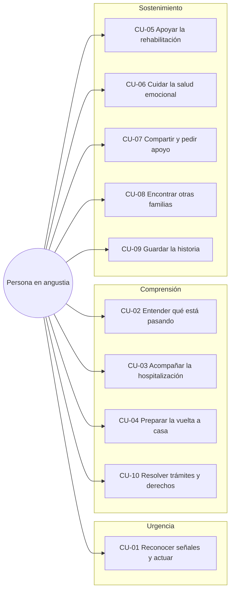

# Usuarios y casos de uso — Mi Experiencia ACV

> **Enfoque de este documento:** definir al usuario principal —una persona común en un momento de angustia que busca información valiosa sobre un ACV— y los casos de uso que se desprenden de esa necesidad. No cubre arquitectura, requisitos técnicos ni roadmap.

---

## 1. Usuario principal

### 1.1 Arquetipo: "La persona que acompaña y necesita entender"

Es una persona común, sin formación médica, que en pocas horas pasa de su rutina a ser el principal apoyo de alguien que acaba de sufrir —o podría estar sufriendo— un accidente cerebrovascular. No viene a leer un manual clínico: viene a saber **qué hacer ahora**, **qué significa lo que está pasando** y **cómo sostener a su familia sin romperse**.

Su búsqueda ocurre en fragmentos: en la sala de urgencias, a las 2 de la mañana, desde el celular, con miedo, culpa y poca batería. Muchas veces no conoce el término "ACV"; busca "se le durmió la cara", "no puede hablar", "derrame cerebral" o "le dio un ataque".

No es un usuario "experto" ni un "paciente": es alguien atravesado por una urgencia emocional y una necesidad práctica de orientación.

> **Nota:** en la etapa de sostenimiento, la persona que vivió el ACV puede asumir parte de estas mismas necesidades. El arquetipo se define desde quien acompaña porque es quien busca información en el momento agudo, pero el producto no debe infantilizar ni excluir a la persona protagonista.

### 1.2 Características

| Dimensión | Descripción |
|---|---|
| **Vínculo** | Hijo/a, pareja, hermano/a, padre/madre, nieto/a, amigo/a o colega de la persona que vivió el ACV. |
| **Conocimiento** | Nulo o básico. No distingue entre ACV isquémico y hemorrágico; no sabe qué es la trombólisis ni la afasia. |
| **Edad** | Amplia, entre 25 y 70 años. La carga de cuidado recae con más frecuencia en mujeres, pero el diseño no debe asumirlo. |
| **Contexto** | Hospital, casa, trabajo o traslado. Conexión variable, tiempo fragmentado, interrupciones constantes. |
| **Estado emocional** | Miedo, urgencia, culpa, confusión, esperanza, agotamiento, sensación de no saber si está haciendo lo correcto. |
| **Alfabetización digital y de salud** | Variable. Puede tener baja familiaridad con términos médicos o con aplicaciones. |
| **Idioma** | Español con variantes locales; necesita ejemplos, teléfonos y trámites de su país. |

### 1.3 Qué necesita de la información

| Necesidad | Qué significa | Ejemplo |
|---|---|---|
| **Confianza** | Saber quién lo dice, cuándo se revisó y de dónde viene. | "Revisado por un neurólogo · Actualizado en agosto de 2026". |
| **Claridad** | Lenguaje simple, sin jerga ni siglas sin explicar. | "El coágulo tapó una arteria" antes que "oclusión de la arteria cerebral media". |
| **Acción** | Un próximo paso concreto, no solo teoría. | "Llama a emergencias y anota la hora en que empezaron los síntomas". |
| **Dosis** | Información por etapa, no todo de golpe. | Primero qué hacer; después qué preguntar; más tarde rehabilitación. |
| **Localidad** | Teléfonos, centros, trámites y derechos del país. | Número de emergencias, centros de rehabilitación, licencias. |
| **Contención** | Tono humano, sin alarmismo ni falsas esperanzas. | "No hay una forma correcta de vivir esto". |
| **Compartibilidad** | Poder enviar algo a otro familiar sin explicarlo todo. | "Compartir esta guía con mi hermano". |
| **Accesibilidad** | Audio, letra grande, bajo consumo de datos. | Escuchar la explicación mientras se está en el hospital. |

### 1.4 Qué no necesita (y qué le hace daño)

- Un diagnóstico o una interpretación de exámenes.
- Artículos académicos sin traducción.
- Promesas de recuperación total o testimonios milagrosos.
- Foros sin moderación con consejos médicos peligrosos.
- Información genérica de otro país.
- Formularios largos antes de recibir la primera respuesta.
- Gamificación, culpa o notificaciones que lo hagan sentir en deuda.

### 1.5 Tres momentos, un mismo usuario

| Momento | Tiempo | Pregunta que lo desvela | Necesidad dominante |
|---|---|---|---|
| **Urgencia** | Minutos | "¿Le está pasando algo grave?" | Actuar a tiempo. |
| **Comprensión** | Horas o días | "¿Qué es esto y qué va a pasar?" | Entender y orientarse. |
| **Sostenimiento** | Semanas o meses | "¿Cómo lo ayudo y cómo me sostengo?" | Cuidar, sostener y no estar solo. |

El usuario no cambia: cambia su pregunta. El producto debe acompañar ese desplazamiento sin obligarlo a empezar de cero.

---

## 2. Usuarios secundarios

No son el foco de este documento, pero condicionan los casos de uso.

| Usuario | Relación con el principal | Rol en los casos de uso |
|---|---|---|
| **Persona protagonista** | Es quien vivió el ACV. | Su dignidad y consentimiento condicionan qué se comparte y cómo se narra. |
| **Cuidador/a principal** | Puede coincidir con el usuario principal o ser otra persona. | Necesita coordinación, relevo y acceso a la misma información. |
| **Familia extendida y amistades** | Quieren saber cómo está y cómo ayudar. | Reciben actualizaciones, reaccionan y ofrecen apoyo concreto. |
| **Lector de la comunidad** | Busca experiencias parecidas, a veces antes de animarse a participar. | Lee historias públicas y puede convertirse en usuario. |
| **Profesional aliado** | Neurólogo, fonoaudiólogo, terapeuta ocupacional, kinesiólogo. | Recomienda recursos y orienta, sin reemplazar la relación clínica. |

---

## 3. Mapa de casos de uso

---

## 4. Casos de uso principales

### 4.1 Resumen

| ID | Pregunta del usuario | Caso de uso | Trabajo emocional | Prioridad |
|---|---|---|---|---|
| **CU-01** | "¿Le está pasando algo grave?" | Reconocer señales de alarma y actuar | Calmar sin minimizar; transmitir urgencia | P0 |
| **CU-02** | "¿Qué es esto y qué va a pasar?" | Entender el ACV y el momento actual | Reducir la incertidumbre | P0 |
| **CU-03** | "¿Qué pregunto y cómo lo acompaño?" | Acompañar la hospitalización | Devolver sensación de control | P1 |
| **CU-04** | "¿Cómo lo cuido en casa?" | Preparar la vuelta a casa y el cuidado diario | Dar confianza para sostener | P1 |
| **CU-05** | "¿Cómo va a ser su rehabilitación?" | Entender y apoyar la rehabilitación | Sostener una esperanza realista | P2 |
| **CU-06** | "¿Y yo quién me cuida?" | Cuidar la salud emocional propia y familiar | Dar permiso para no poder con todo | P1 |
| **CU-07** | "¿Cómo aviso a la familia sin repetir todo?" | Compartir la experiencia y pedir apoyo | Aliviar la carga de ser el intermediario | P1 |
| **CU-08** | "¿Alguien más pasó por esto?" | Encontrar otras familias | Sentirse comprendido | P2 |
| **CU-09** | "¿Cómo no olvidar lo que estamos viviendo?" | Guardar y ordenar la historia | Dar sentido a lo vivido | P2 |
| **CU-10** | "¿Qué trámites y derechos tengo?" | Resolver trámites y acceder a recursos | Orientación práctica | P2 |

### 4.2 Detalle

#### CU-01 · Reconocer señales de alarma y actuar

- **Disparador:** aparición súbita de debilidad en la cara o un brazo, dificultad para hablar, pérdida de visión, vértigo intenso, pérdida de equilibrio o dolor de cabeza muy intenso.
- **Objetivo:** llamar a emergencias de inmediato, sin esperar a que "se le pase".
- **Necesita saber:** señales de alarma, número de emergencias local, qué información tener a mano (hora de inicio de los síntomas, edad, medicamentos) y qué no hacer mientras llega la ayuda.
- **Rol del producto:** mostrar una explicación de 30 segundos, un botón de llamada y una advertencia clara de que no es un diagnóstico. Nunca hacer triaje ni preguntar "¿cree que es un ACV?".
- **Resultado esperado:** la persona llama a emergencias o acude a urgencias; entiende que el tiempo es crítico.
- **Riesgo si falla:** falsa tranquilidad, demora o automedicación.
- **Prioridad:** P0.

#### CU-02 · Entender qué es un ACV y qué está pasando

- **Disparador:** diagnóstico reciente o términos médicos que la persona no comprende ("isquémico", "trombólisis", "afasia", "hemiparesia").
- **Objetivo:** entender en lenguaje claro qué ocurrió, qué significa y qué puede esperar en las próximas horas y días.
- **Necesita saber:** qué es un ACV, diferencia entre isquémico y hemorrágico, qué son los tratamientos iniciales, qué significan los términos que escucha y qué preguntas hacer al equipo médico.
- **Rol del producto:** explicador progresivo, con audio, ejemplos y un glosario; opción "explícamelo como si no supiera nada". Sin interpretar exámenes ni dar pronósticos.
- **Resultado esperado:** puede explicarle la situación a otro familiar con sus propias palabras y lleva al menos tres preguntas concretas al equipo médico.
- **Riesgo si falla:** sobrecarga, interpretación errónea, búsqueda en fuentes poco confiables.
- **Prioridad:** P0.

#### CU-03 · Acompañar la hospitalización y saber qué preguntar

- **Disparador:** hospitalización, unidad de cuidados intensivos, cambios de turno y de médicos, sensación de no entender qué está pasando.
- **Objetivo:** orientarse, hacer las preguntas correctas y mantener informada a la familia sin repetir la misma historia a cada persona.
- **Necesita saber:** qué preguntar en cada etapa, qué llevar al hospital, cuáles son sus derechos, cómo comunicarse con el equipo y cómo compartir una actualización.
- **Rol del producto:** guía de hospitalización con checklist de preguntas y un espacio privado para publicar actualizaciones.
- **Resultado esperado:** lleva una lista de preguntas y publica una actualización que su círculo puede leer.
- **Riesgo si falla:** sentirse excluido de las decisiones, aumentar la ansiedad, sobrecargar al cuidador.
- **Prioridad:** P1.

#### CU-04 · Preparar la vuelta a casa y el cuidado diario

- **Disparador:** alta hospitalaria, adaptación del hogar, miedo a equivocarse en el cuidado cotidiano.
- **Objetivo:** saber qué preparar, cómo acompañar en el día a día y cuándo pedir ayuda.
- **Necesita saber:** checklist de hogar, señales de alarma, movilidad, alimentación, higiene, prevención de caídas, a quién llamar y cómo organizar el cuidado.
- **Rol del producto:** checklist práctica y recursos locales, con contenido revisado por especialistas y sin indicaciones de medicamentos ni dosis.
- **Resultado esperado:** completa la checklist y reconoce las señales que requieren consulta inmediata.
- **Riesgo si falla:** accidentes evitables, sobrecarga, readmisión.
- **Prioridad:** P1.

#### CU-05 · Entender y apoyar la rehabilitación

- **Disparador:** inicio de la rehabilitación, meseta en el progreso, frustración de la familia o de la persona protagonista.
- **Objetivo:** entender qué terapias existen, cuál es el rol de la familia y cómo acompañar sin reemplazar al profesional.
- **Necesita saber:** diferencias entre kinesiología, terapia ocupacional y fonoaudiología; tiempos realistas; cómo celebrar avances; qué no hacer; preguntas para el equipo.
- **Rol del producto:** guías por etapa, hitos y espacios para registrar avances.
- **Resultado esperado:** distingue las terapias, entiende su rol y registra al menos un avance.
- **Riesgo si falla:** expectativas irreales, abandono de la terapia, culpa.
- **Prioridad:** P2.

#### CU-06 · Cuidar la salud emocional propia y de la familia

- **Disparador:** agotamiento, culpa, tristeza, aislamiento, conflictos familiares o miedo a "no poder más".
- **Objetivo:** reconocer el desgaste, encontrar permiso para cuidarse y saber dónde pedir ayuda.
- **Necesita saber:** señales de agotamiento del cuidador, microcuidados posibles, relevos, grupos de apoyo, líneas de crisis y cómo hablar con niños y adolescentes.
- **Rol del producto:** sección "cuidar a quien cuida", autoevaluación no diagnóstica y recursos de crisis visibles.
- **Resultado esperado:** identifica una acción concreta para esta semana y sabe a dónde acudir si necesita ayuda profesional.
- **Riesgo si falla:** burnout, deterioro de la salud mental, negligencia involuntaria.
- **Prioridad:** P1.

#### CU-07 · Compartir la experiencia y pedir apoyo sin repetir la historia

- **Disparador:** decenas de mensajes preguntando "¿cómo está?", llamadas, agotamiento de contar lo mismo.
- **Objetivo:** compartir lo que está pasando con un círculo elegido, pedir ayuda concreta y proteger la privacidad de la persona protagonista.
- **Necesita saber:** cómo escribir una actualización breve, a quién invitar, qué puede compartir y cómo pedir algo específico ("necesito compañía el jueves", "¿alguien puede llevar comida?").
- **Rol del producto:** espacio privado con roles, actualizaciones, reacciones y enlaces revocables.
- **Resultado esperado:** publica una actualización, invita al menos a una persona y reduce los mensajes repetidos.
- **Riesgo si falla:** exposición no consentida, aislamiento, sensación de estar "gestionando" a la familia.
- **Prioridad:** P1 (es el diferenciador del producto).

#### CU-08 · Encontrar otras familias y sentirse comprendido

- **Disparador:** sensación de soledad, "nadie entiende lo que estamos viviendo", necesidad de escuchar experiencias reales.
- **Objetivo:** leer o escuchar historias parecidas, validar lo que siente y aprender de otras familias.
- **Necesita saber:** que no está solo, cómo otros atravesaron etapas similares y qué les ayudó; sin consejos médicos ni comparaciones culpabilizantes.
- **Rol del producto:** comunidad moderada, filtrable por etapa y vínculo, con avisos de contenido sensible.
- **Resultado esperado:** encuentra una historia con la que se identifica y la guarda, reacciona o comenta.
- **Riesgo si falla:** desinformación, comparación dañina, exposición.
- **Prioridad:** P2.

#### CU-09 · Guardar y ordenar la historia para no perderla

- **Disparador:** miedo a olvidar detalles, deseo de mostrarle a la persona protagonista o a la familia lo que vivieron, necesidad de dar sentido al proceso.
- **Objetivo:** registrar momentos, fotos, audios e hitos, y armar un relato que pueda conservarse.
- **Necesita saber:** que lo que escribe es privado, que puede editarlo y que puede exportarlo cuando quiera.
- **Rol del producto:** diario, línea de tiempo, capítulos y exportación a libro.
- **Resultado esperado:** registra al menos tres momentos y comparte o exporta la historia.
- **Riesgo si falla:** pérdida de memoria, sensación de que "no queda nada".
- **Prioridad:** P2.

#### CU-10 · Resolver trámites y acceder a recursos locales

- **Disparador:** licencia médica, certificado de discapacidad, seguros, subsidios, cuidado domiciliario o dudas sobre derechos.
- **Objetivo:** saber qué le corresponde, qué necesita y dónde hacerlo.
- **Necesita saber:** requisitos, plazos, documentos, oficinas y enlaces oficiales de su país.
- **Rol del producto:** directorio de recursos con fuente, fecha de actualización y advertencia de que no es asesoría legal.
- **Resultado esperado:** identifica el próximo paso y el lugar o enlace donde hacerlo.
- **Riesgo si falla:** pérdida de beneficios, trámites innecesarios, frustración.
- **Prioridad:** P2.

---

## 5. Priorización

| Prioridad | Casos de uso | Criterio |
|---|---|---|
| **P0** | CU-01, CU-02 | Riesgo vital o necesidad inmediata de comprensión. |
| **P1** | CU-03, CU-04, CU-06, CU-07 | Primeras semanas, sostenibilidad del cuidado y diferenciador del producto. |
| **P2** | CU-05, CU-08, CU-09, CU-10 | Proceso de largo plazo, comunidad y valor de memoria. |

---

## 6. Condiciones transversales de los casos de uso

1. **Responder antes de pedir.** Ningún caso de uso exige registro o formularios largos para entregar la primera orientación.
2. **Una pregunta a la vez.** La información se dosifica según el momento; no se muestra todo el proceso de golpe.
3. **Emergencia siempre visible.** El acceso a señales de alarma y números de emergencia está presente en todo el producto, sin competir con el resto.
4. **Lenguaje claro y humano.** Sin jerga sin explicar, sin alarmismo, sin falsas esperanzas.
5. **Fuente y fecha.** Todo contenido clínico o legal muestra quién lo revisó y cuándo.
6. **Privacidad por defecto.** Compartir es una decisión explícita, nunca el comportamiento inicial.
7. **No diagnóstico, no prescripción.** El producto orienta y acompaña; no interpreta exámenes ni indica tratamientos.
8. **Accesible en el peor momento.** Letra grande, audio, bajo consumo, navegación con una mano y tolerancia a la interrupción.

---

## 7. Lo que el usuario debería poder decir después

- "Sé qué hacer ahora."
- "Entiendo lo que le está pasando."
- "Tengo las preguntas para hacerle al médico."
- "No estoy solo."
- "Puedo contarlo sin tener que repetirlo mil veces."
- "Lo que vivimos quedó guardado."

Estas frases son el verdadero criterio de éxito de los casos de uso.
